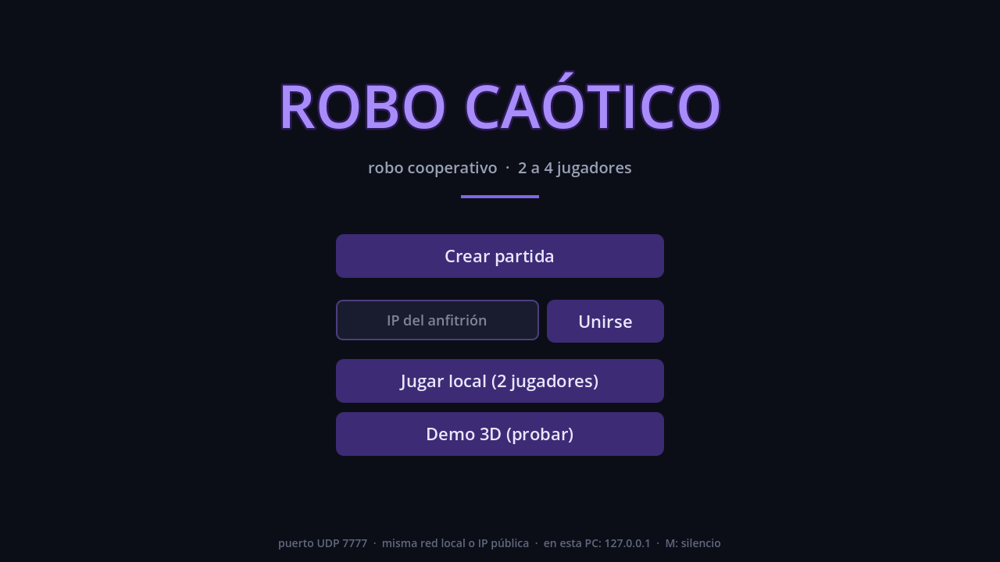
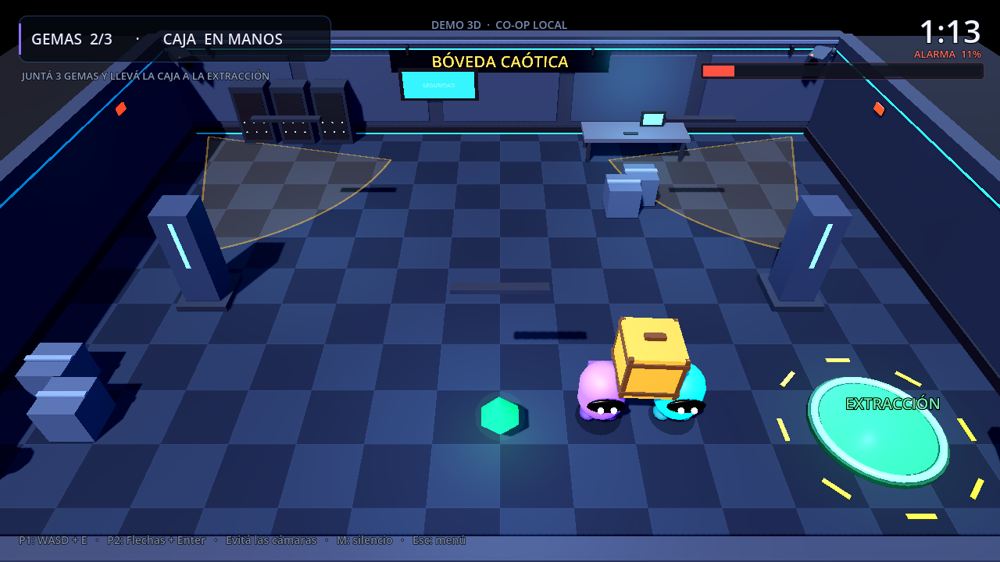
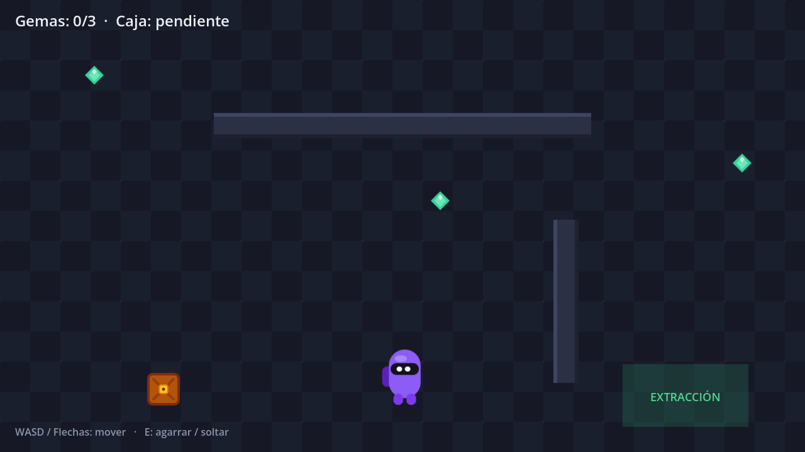

# Robo Caótico — Prototipo 0.7

Prototipo de robo cooperativo para Steam. El juego principal sigue siendo **2D**; esta versión suma una **demo 3D separada** para comparar la dirección visual antes de invertir más arte.







## Estado actual

### Juego 2D (principal)

- Arte flat vector estilo Among Us (personajes, caja, gemas, baldosas)
- **Multijugador en red**: partidas de 2 a 4 jugadores por IP directa (ENet/UDP)
- **Co-op local 2 jugadores**: P1 (violeta) y P2 (cian)
- Movimiento top-down con colisiones
- **Agarre cooperativo**: la caja se lleva entre uno (45% de velocidad) o entre dos (80%), y se ubica en el punto medio entre ambos
- **Ronda de 2 minutos** con cuenta regresiva
- **Cámaras de seguridad**: si te ven, la alarma sube; al 100% perdés. Sin nadie a la vista, baja sola
- **Sonido y música originales**, generados por código: loops de menú y de golpe, efectos de gemas, agarre, entrega, pasos, cámara, alarma y victoria/derrota
- **Feedback visual**: partículas, viñeta roja que crece con la alarma, personajes que saltan al caminar, caja que se tambalea, zona de extracción que respira y HUD animado
- Pantalla de fin (victoria / derrota)
- **Mini-bucle**: juntar las 3 gemas y llevar la caja a EXTRACCIÓN antes de que se acabe el tiempo o salte la alarma
- El host manda: valida agarres, gemas, tiempos y entrega, y sincroniza todo a los clientes

### Demo 3D (experimento)

- Una sala 3D construida por código, con servidores, escritorio, pilares, plantas, lámparas y una bóveda
- **El mismo bucle**: 3 gemas + caja cooperativa + extracción + temporizador + alarma
- **2 jugadores locales** en la misma PC, con cámara elevada en perspectiva: los personajes se ven en 3D, con visor, mochila y animación de caminata
- **Cámaras de seguridad 3D** con cono de visión, detección por línea de vista y cambio a rojo cuando te ven
- **Caja cooperativa** que se eleva entre los dos portadores y se entrega en la plataforma verde
- HUD, viñeta de peligro, partículas 3D, sonidos y pantalla de fin
- **Importante**: esta demo **no tiene red**, es un vertical slice para decidir si el 3D vale la pena. El juego 2D es el que tiene multijugador.

## Cómo abrir el proyecto

```bash
godot --path ~/Documentos/game
```

O abrir Godot, **Import** y seleccionar esta carpeta. Dentro del editor, **F5** para jugar.

## Cómo jugar

En el menú:

- **Crear partida**: abre una sala 2D en el puerto UDP 7777.
- **Unirse**: escribí la IP del anfitrión y tocá Unirse.
- **Jugar local**: 2 jugadores en la misma PC, en 2D.
- **Demo 3D (probar)**: entra a la demo 3D local.

Para probar el multijugador en la misma PC, abrí **dos instancias** del juego: en una creá la partida y en la otra uníte a `127.0.0.1`.

Para jugar en LAN, el anfitrión pasa su IP local (por ejemplo con `hostname -I`) y el otro se une a esa IP. Para jugar por internet hay que abrir/redirigir el puerto **UDP 7777** en el router del anfitrión; todavía no hay lobbies de Steam ni NAT punch.

También se puede arrancar directo desde la terminal:

```bash
godot --path ~/Documentos/game -- --host
godot --path ~/Documentos/game -- --join=127.0.0.1
godot --path ~/Documentos/game -- --local
godot --path ~/Documentos/game -- --demo3d
```

La demo 3D también se puede abrir directo:

```bash
godot --path ~/Documentos/game scenes/demo3d.tscn
```

## Controles

| Acción | Jugador 1 | Jugador 2 (local) |
|---|---|---|
| Mover | WASD | Flechas |
| Agarrar / soltar caja | E | Enter |
| Reiniciar al terminar | R | R |
| Volver al menú | Esc | Esc |
| Silenciar todo el audio | M | M |

En red cada jugador usa **WASD + E**. **M** silencia o reactiva el audio del juego en cualquier momento.

## Estructura

```
scenes/        menu, main (2D), demo3d (3D), player, player2, player3d,
               gem, gem3d, crate, crate3d, extraction_zone, security_camera,
               security_camera3d
scripts/       GDScript de cada escena + audio.gd (autoload) + effects.gd
assets/art/    SVGs (personajes, caja, gema, sombra, baldosa, chispa)
assets/audio/  SFX y música en WAV (generados, sin samples externos)
assets/shaders/ viñeta de peligro + baldosas 3D
tools/         generate_audio.py (audio reproducible)
```

## Cómo regenerar el audio

El audio se puede reconstruir desde cero con Python 3 (solo biblioteca estándar):

```bash
cd ~/Documentos/game
python3 tools/generate_audio.py
godot --headless --path . --import
godot --headless --path . --import
```

La primera importación puede avisar que los WAV recién creados no tienen loader; la segunda pasada los deja listos. Los WAV se importan sin compresión (PCM) para que los loops de música no tengan artefactos.

## Limitaciones actuales

- La **demo 3D es local y de una sola sala**; no tiene red, lobbies ni voz
- El multijugador 2D funciona por IP directa (UDP 7777), sin lobbies de Steam
- 2 a 4 jugadores por partida en 2D
- Sin voz ni chat
- Si un jugador se desconecta, sale de la partida (no hay reconexión)
- El arte 3D y los personajes son procedurales: sirven para comparar, no son el acabado final
- El audio está generado por código: sirve para el prototipo, pero todavía no es una banda sonora profesional

## Decisión pendiente y siguiente paso

1. Probar la **Demo 3D** desde el menú y comparar con el 2D.
2. Decidir si el proyecto sigue en 2D o si conviene preparar una migración a 3D.
3. Después, el roadmap sigue con **modo traidor**, **lobbies de Steam** (y voz por proximidad), más mapas y la página de Steam.
