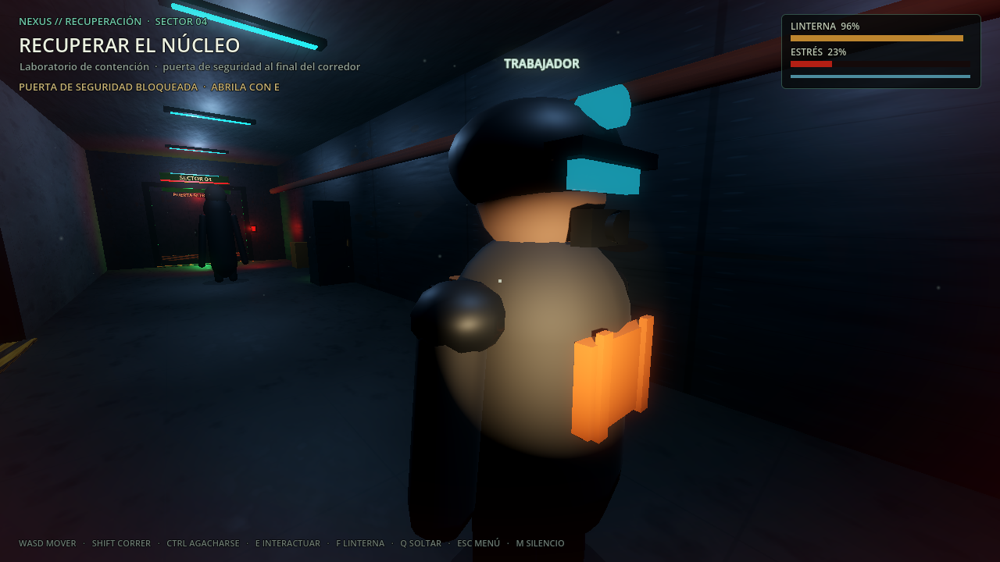
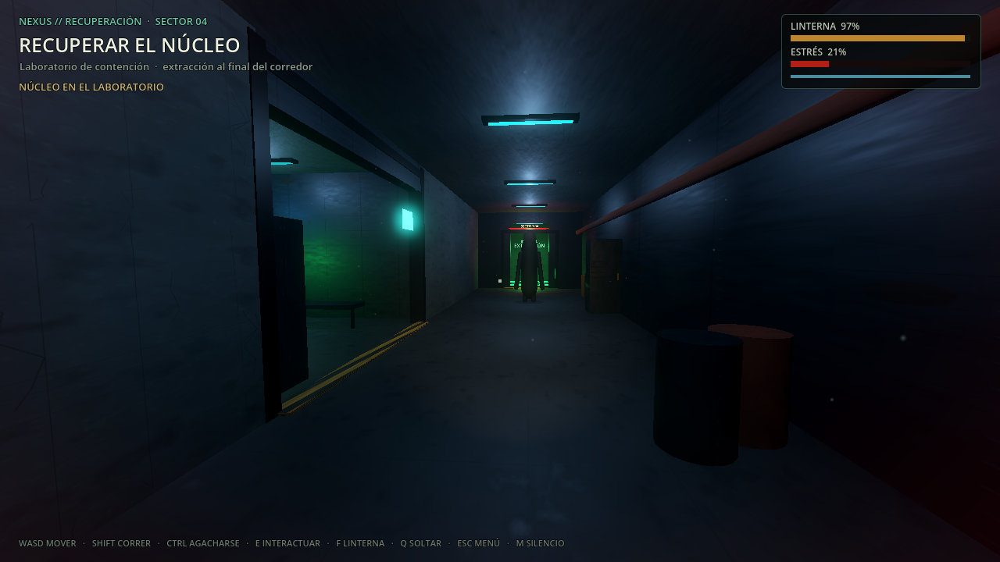
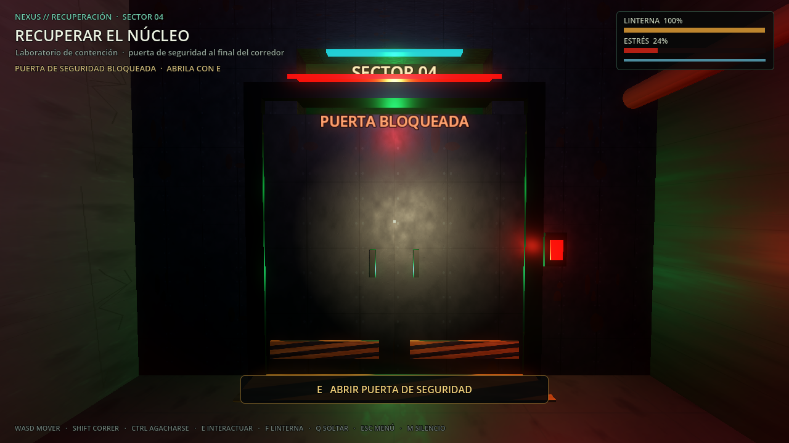
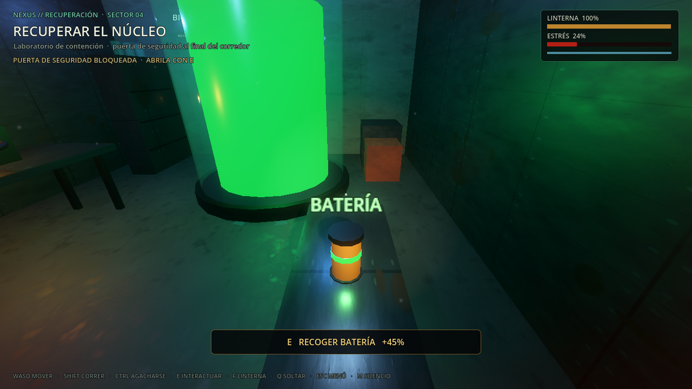
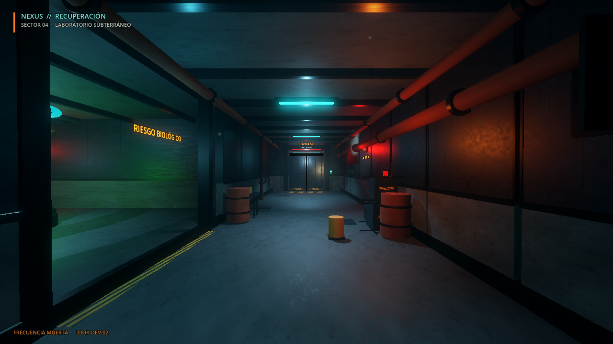
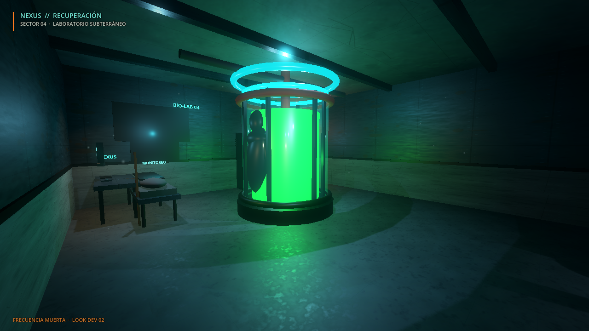
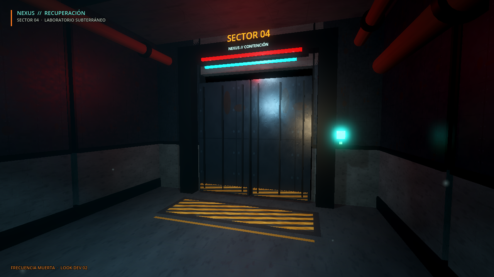
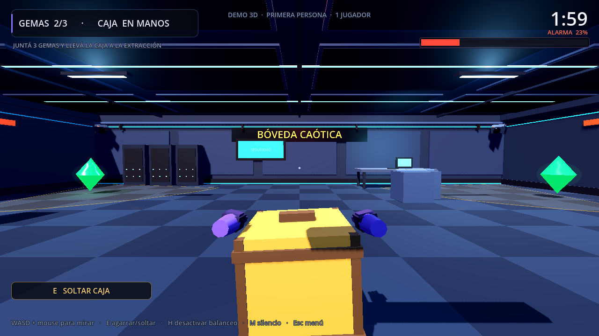

# FRECUENCIA MUERTA

**Terror cooperativo online. No todas las voces que escuchas pertenecen a tus compañeros.**

## Fase 3 — Vertical slice jugable y online (P2 implementado, MVP)

La primera versión jugable de FRECUENCIA MUERTA ya está en el proyecto. El
**vertical slice** incluye corredor industrial, laboratorio de contención, puerta de
seguridad interactiva, linterna con batería, un objeto físico, dos escondites, El
Vigilante, estrés, trampa sonora, audio ambiental 3D y extracción. Sin armas y sin
combate.

**Novedad P2:** el vertical slice ya se puede jugar **entre dos instancias por red**
(ENet, puerto UDP 7777). El host manda sobre la partida: valida interacciones, puerta,
baterías, trampa, núcleo, criatura, extracción y final. El movimiento de cada cliente
es local y el host valida las acciones por distancia; es la misma filosofía del
prototipo 2D, no un servidor con simulación completa de movimiento.




| Cómo probar | Comando |
|---|---|
| Host 3D | Menú **CREAR PARTIDA 3D (HOST)** o `godot --path ~/Documentos/game -- --host3d` |
| Cliente 3D | Menú: IP `127.0.0.1` + **UNIRSE 3D**, o `godot --path ~/Documentos/game -- --join3d=127.0.0.1` |
| Offline | Menú **ENTRAR A LA INSTALACIÓN** o `godot --path ~/Documentos/game -- --slice` |

- Documentación de red: [docs/fm_online.md](docs/fm_online.md).
- Para LAN, el host comparte su IP local; para internet hay que abrir/redirigir **UDP 7777**. Todavía no hay lobbies de Steam, reconexión ni voz.



| Captura | Qué muestra |
|---|---|
|  | Puerta interactiva cerrada, con prompt |
|  | Batería recogible para la linterna |

- Cómo abrirla: botón **ENTRAR A LA INSTALACIÓN** del menú, o `godot --path ~/Documentos/game -- --slice`
- Escena: `scenes/fm/vertical_slice.tscn`
- La criatura se detiene cuando la observás; si dejás de mirarla, se mueve.
- El núcleo está en el laboratorio; hay que llevarlo a la extracción al final del corredor.
- La puerta de seguridad se abre con E; el ruido puede atraer al Vigilante.
- Hay dos baterías recogibles que recargan la linterna; los cristales del corredor hacen ruido al pisarlos.
- La linterna consume batería. Los escondites reducen el riesgo, pero no son invisibilidad absoluta.
- El lookdev de Fase 2 se conserva como referencia visual y se puede abrir desde el menú.
- Documentación detallada: [docs/fm_vertical_slice.md](docs/fm_vertical_slice.md).

| Acción | Tecla |
|---|---|
| Mover | WASD |
| Mirar | Mouse |
| Correr / agacharse | Shift / Ctrl |
| Interactuar, recoger, esconderse, salir o abrir puerta | E |
| Soltar el núcleo | Q |
| Linterna | F |
| Volver al menú | Esc |
| Reintentar (offline) / volver al menú (online) al terminar | R |
| Silenciar audio | M |

**Limitaciones de esta versión:** el modo online es de prototipo, sin lobbies de Steam,
reconexión ni voz; el movimiento se confía al cliente y el host valida las acciones por
distancia. El Vigilante y los objetos usan geometría procedural provisional; no hay
inventario, herramientas, base ni progresión. El Imitador llega en una fase posterior.

Pruebas básicas versionadas:

```bash
bash tests/run_all.sh
```

Resultados actuales: vertical slice offline **26/26**, red 3D **15/15**, juego 2D **16/16**, red 2D **6/6**.
Los tests dejan avisos de recursos al forzar la salida; no son fallos de gameplay.

## Fase 2 — Identidad visual y look dev

La nueva dirección del proyecto es **FRECUENCIA MUERTA**: un juego de terror y extracción cooperativa en 3D en primera persona, sin armas y sin combate. Esta fase construyó una escena visual para validar la atmósfera, los materiales, la iluminación y el rendimiento antes de invertir en el vertical slice jugable.

| Captura | Qué muestra |
|---|---|
|  | Corredor industrial de acceso |
|  | Laboratorio de contención |
|  | Puerta de seguridad |

- Cómo abrirla: `godot --path ~/Documentos/game scenes/fm/lookdev.tscn`
- Documentación completa: [`docs/fm_lookdev.md`](docs/fm_lookdev.md)
- Renderer: **Forward+**.
- Rendimiento medido: 95-99 FPS a 1080p en el corredor, 92-94 FPS en el laboratorio (GTX 1650 Ti).
- La escena es un **look dev**: no tiene jugador, criaturas, IA, loot ni red.
- Los prototipos anteriores se conservan más abajo como banco de pruebas e historial.

---

# Historial de prototipos — Robo Caótico 0.8

> **Nota:** esta sección describe el estado anterior del proyecto y se conserva como historial.
> El estado actual de FRECUENCIA MUERTA es el de la parte superior del README.

Prototipo de robo cooperativo para Steam. La dirección elegida es **3D en primera persona y online**. El juego 2D sigue siendo la base jugable con red; la demo 3D elevada queda como referencia y la demo FP sirve para validar la cámara, la caja y el nivel antes de invertir en el multijugador 3D.




## Estado actual

### Prototipo 3D en primera persona (nuevo)

- Una sala 3D con techo, vigas, lámparas, servidores, escritorio, pilares y bóveda
- **Cámara en primera persona** a la altura de los ojos, mirada con mouse
- **Manos visibles** y caja sostenida delante del jugador
- **El mismo bucle**: 3 gemas + caja + extracción + temporizador + alarma
- **Cámaras de seguridad 3D** con cono de visión, detección por línea de vista y aviso rojo
- HUD con punto de mira, aviso de agarre/soltar, viñeta de peligro, partículas y sonidos
- **Importante**: es un prototipo **offline y de un solo jugador**. No es el modo local final ni tiene red todavía; sirve para decidir si la primera persona se siente bien.

### Juego 2D (base jugable)

- Arte flat vector estilo Among Us (personajes, caja, gemas, baldosas)
- **Multijugador en red**: partidas de 2 a 4 jugadores por IP directa (ENet/UDP)
- **Co-op local 2 jugadores**: P1 (violeta) y P2 (cian), usado como banco de pruebas
- Movimiento top-down con colisiones
- **Agarre cooperativo**: la caja se lleva entre uno (45% de velocidad) o entre dos (80%), y se ubica en el punto medio entre ambos
- **Ronda de 2 minutos** con cuenta regresiva
- **Cámaras de seguridad**: si te ven, la alarma sube; al 100% perdés. Sin nadie a la vista, baja sola
- **Sonido y música originales**, generados por código
- **Feedback visual**: partículas, viñeta roja, personajes animados, caja que se tambalea, zona de extracción que respira y HUD animado
- Pantalla de fin (victoria / derrota)
- **Mini-bucle**: juntar las 3 gemas y llevar la caja a EXTRACCIÓN antes de que se acabe el tiempo o salte la alarma
- El host manda: valida agarres, gemas, tiempos y entrega, y sincroniza todo a los clientes

### Demo 3D elevada (referencia)

- Una sala 3D construida por código, con servidores, escritorio, pilares, plantas y lámparas
- **El mismo bucle**: 3 gemas + caja cooperativa + extracción + temporizador + alarma
- **2 jugadores locales** con cámara elevada en perspectiva
- **Cámaras de seguridad 3D** con cono de visión y detección por línea de vista
- **Caja cooperativa** que se eleva entre los dos portadores
- HUD, viñeta de peligro, partículas 3D, sonidos y pantalla de fin
- **No tiene red**; se conserva como comparación visual y de jugabilidad

## Dirección del proyecto

- El juego final será **3D en primera persona y cooperativo online**, para 2 a 4 jugadores.
- **No habrá co-op local de dos ni pantalla dividida**. El botón "Prueba 2D local" es solo un banco de pruebas para iterar mecánicas sin red.
- El siguiente salto técnico es llevar el prototipo FP a online con ENet. Steam, lobbies y voz por proximidad vienen después.

## Cómo abrir el proyecto

```bash
godot --path ~/Documentos/game
```

O abrir Godot, **Import** y seleccionar esta carpeta. Dentro del editor, **F5** para jugar.

## Cómo jugar

En el menú:

- **Entrar a la instalación**: vertical slice offline de FRECUENCIA MUERTA.
- **Crear partida 2D**: abre una sala 2D en el puerto UDP 7777.
- **Unirse**: escribí la IP del anfitrión y tocá Unirse.
- **Prueba 2D local**: banco de pruebas de 2 jugadores en la misma PC, en 2D.
- **Demo 3D**: demo 3D local con cámara elevada y 2 jugadores.
- **Demo 3D FPS**: prototipo en primera persona, offline y de un jugador.
- **Ver lookdev**: escena de referencia visual de Fase 2.

Para probar el multijugador 2D en la misma PC, abrí **dos instancias** del juego: en una creá la partida y en la otra uníte a `127.0.0.1`.

Para jugar en LAN, el anfitrión pasa su IP local (por ejemplo con `hostname -I`) y el otro se une a esa IP. Para jugar por internet hay que abrir/redirigir el puerto **UDP 7777** en el router del anfitrión; todavía no hay lobbies de Steam ni NAT punch.

También se puede arrancar directo desde la terminal:

```bash
godot --path ~/Documentos/game -- --host
godot --path ~/Documentos/game -- --join=127.0.0.1
godot --path ~/Documentos/game -- --local
godot --path ~/Documentos/game -- --demo3d
godot --path ~/Documentos/game -- --demo3dfp
```

Las demos 3D también se pueden abrir directo:

```bash
godot --path ~/Documentos/game scenes/demo3d.tscn
godot --path ~/Documentos/game scenes/demo3d_fp.tscn
```

## Controles

| Acción | 2D / 3D elevada | 3D primera persona |
|---|---|---|
| Mover | WASD (P2: flechas) | WASD |
| Mirar | — | Mouse |
| Agarrar / soltar caja | E (P2: Enter) | E |
| Reiniciar al terminar | R | R |
| Volver al menú | Esc | Esc |
| Silenciar todo el audio | M | M |
| Desactivar balanceo de cámara | — | H |

En primera persona, si el mouse se libera, un clic lo vuelve a capturar. **M** silencia o reactiva el audio en cualquier momento.

## Estructura

```
scenes/        menu, main (2D), demo3d (3D elevada), demo3d_fp (3D FP),
               player, player2, player3d, gem, gem3d, crate, crate3d,
               extraction_zone, security_camera, security_camera3d
scripts/       GDScript de cada escena + player_fp3d.gd + audio.gd (autoload)
assets/art/    SVGs (personajes, caja, gema, sombra, baldosa, chispa)
assets/audio/  SFX y música en WAV (generados, sin samples externos)
assets/shaders/ viñeta de peligro + baldosas 3D
tools/         generate_audio.py (audio reproducible)
```

## Cómo regenerar el audio

El audio se puede reconstruir desde cero con Python 3 (solo biblioteca estándar):

```bash
cd ~/Documentos/game
python3 tools/generate_audio.py
godot --headless --path . --import
godot --headless --path . --import
```

La primera importación puede avisar que los WAV recién creados no tienen loader; la segunda pasada los deja listos. Los WAV se importan sin compresión (PCM) para que los loops de música no tengan artefactos.

## Verificación

- Test de integración del prototipo FP: **16/16 PASS** (cámara, aviso de agarre/soltar, caja delante, detección, alarma, gema, entrega y victoria)
- Test del juego 2D: **16/16 PASS**
- Test de red 2D: **6/6 PASS** (host + cliente en la misma PC)
- Smoke test de la demo 3D elevada: sin errores de script
- La demo FP arranca sin errores con `godot --headless --path . --quit-after 90 scenes/demo3d_fp.tscn`

## Limitaciones actuales

- El prototipo **3D FP es offline y de un solo jugador**; todavía no tiene red
- La demo **3D elevada es local de 2** y no tiene red
- El multijugador 2D funciona por IP directa (UDP 7777), sin lobbies de Steam
- 2 a 4 jugadores por partida en 2D
- Sin voz ni chat
- Si un jugador se desconecta, sale de la partida (no hay reconexión)
- El arte 3D y los personajes son procedurales: sirven para comparar, no son el acabado final
- El audio está generado por código: sirve para el prototipo, pero todavía no es una banda sonora profesional

## Siguiente paso

1. Probar la **Demo 3D FPS** desde el menú y validar cámara, manos, caja y cámaras.
2. Llevar el prototipo FP a **online 3D con ENet**: servidor autoritativo, 2 a 4 jugadores, sincronización de cuerpos, caja, gemas, alarma y temporizador.
3. Después: **lobbies de Steam**, voz por proximidad, modo traidor, más salas y página de Steam.
