# FRECUENCIA MUERTA — Auditoría de calidad de objetos y coherencia de servicios

**Fecha:** 2026-11-09  
**Archivo:** `nexus/nivel_01/FM_LEVEL1_V06_ARCH.blend`  
**Escena:** `NEXUS_L1_V06_ARCH`  
**Blender:** 5.2.3 LTS  
**Tipo:** auditoría de solo lectura. No se ha modificado ni guardado el `.blend`. No hay commit.  
**Referencia de calidad:** `L1_SECURITY_R2_HERO` (158 mallas, 35.082 tris), checkpoint de acceso de Seguridad 03.

---

## 1. Veredicto ejecutivo

El listón hero existe, pero está aislado. El checkpoint de Seguridad es un kitbash denso, con biseles, herrajes, cables, tornillos, rejillas y calibres correctos; el resto de la escena no comparte ese lenguaje. La auditoría mide **737 objetos** de las familias solicitadas y encuentra:

| Severidad | Objetos | Lectura |
|---|---:|---|
| Crítico | 205 | No pueden entrar en la biblioteca en su estado actual |
| Alto | 69 | Entran solo después de una corrección localizada |
| Medio | 206 | Sirven como base, pero necesitan desgaste, UV o LOD |
| Bajo / reutilizable | 224 | 158 son el propio checkpoint hero; el resto son props menores |
| Oculto / legado | 33 | Duplicados antiguos; no instanciar |

**Tres conclusiones que bloquean la biblioteca compartida:**

1. **El shell de Seguridad no es hero.** Son 36 objetos y 768 triángulos: suelo, muros, techo y columnas son cajas de 8 vértices y 12 triángulos, sin bisel, con 21 de 36 mallas sin UV y materiales planos de blockout. El suelo de Seguridad es un color plano granate (`M_L1_Zone_Security.010`, base 0,30/0,12/0,10) que en render se lee como salmón, no como hormigón industrial. El techo sí usa una textura PBR (`M_FM_Concrete_Wall`), lo que crea una incoherencia visible dentro de la misma sala.
2. **Los servicios no son un sistema, son set dressing.** Hay 228 objetos de servicios y 124.030 triángulos. La mayor parte del peso (75.010 triángulos) son cables de detalle; los objetos sin “cable” en el nombre —ductos, bandejas, sprinklers, risers y conductos— suman 49.020 triángulos: 38.476 en Z10, 2.448 en recepción y 8.096 en Seguridad. El corredor principal de 174 m, los vestíbulos, las escaleras y el laboratorio tienen **cero** servicios. Los tramos de recepción y Seguridad terminan en el aire, sin rejillas, sin montantes, sin soportes y sin pasamuros.
3. **La recepción es blockout puro.** 121 objetos de mobiliario, taquillas, barreras y papeleras a 60 triángulos por objeto, sin bisel, con materiales planos y UV de proyección de caja al 100 % solapada. El escritorio, las sillas, los monitores y el teclado no se pueden defender como assets de biblioteca.

**No crear la biblioteca todavía.** El primer paso no es empaquetar lo que hay: es congelar el estado actual, etiquetar generaciones (`BLOCKOUT`, `LEGACY`, `HERO`) y reconstruir un tramo de referencia de shell + servicios + puertas + luminarias. Sin esa referencia, cualquier asset nuevo se colocará sobre un entorno que aún cambia de escala y de criterio.

---

## 2. Alcance, método y evidencia

### 2.1. Objetos medidos

Se inventariaron y midieron **737 objetos** de las familias solicitadas:

- Emergencias y luminarias de techo de Seguridad.
- Puertas, marcos y vanos (Seguridad N/S, recepción, Z10).
- Taquillas de recepción, Seguridad y Z10.
- Sillas, escritorios, monitores, teclados y lectores.
- Barreras, stanchions, bins, crates, barriles, cable reels y tool carts.
- Shell de Seguridad (suelo, muros, columnas, techo).
- Servicios: tuberías, ductos, bandejas, conductos, sprinklers, risers, desagües, cables y soportes.

Además se revisaron visualmente los conjuntos completos `L1_SECURITY_R21A/B/C/D`, `L1_SECURITY_R2_HERO`, `L1_RECEPTION_R1/R2/R3/R5`, `L1_KIT_PILOT` y `L1_PROPS_Z10`. Como referencias adicionales se revisaron `R21C_SHELF_Unit`, `R21C_KEYS_KeyRack` y `R21A_CCTV_*`; no se suman al recuento de 737. La escena tiene 2.159 objetos, 2.079 mallas y 1.111.526 triángulos; la muestra de 737 es la que se midió objeto a objeto.

### 2.2. Métricas por objeto

Para cada malla se registró: colección, vértices, caras, triángulos, dimensiones, materiales, UVs, área UV, área de mundo, densidad de texel, modificadores, escala, duplicados de vértices, caras n-gon, caras degeneradas, aristas de borde y aristas no manifold. Se calcularon firmas geométricas para detectar copias y se ejecutó el gate `qa_check.py` de la skill `blender-asset-qa` con perfil `game` sobre una treintena de assets representativos. El gate evalúa la malla con modificadores, por lo que sus conteos pueden superar los tris base de las tablas.

Resultado de la duplicación: **439 de los 737 objetos comparten firma geométrica con otro objeto** (mismo vértice/cara/dimensiones/materiales) pero usan mallas independientes. La escena guarda copias, no instancias. Ejemplos: 7 carcasas de luminaria, 7 paneles, 2 carteles de techo, 4 barriles, 2 crates, 2 tool carts, 2 cable reels, 6 puertas de taquilla y 8 sillas de briefing.

### 2.3. Renders

Todos los renders son **1280×720**, EEVEE, con cámara y luces temporales creadas y eliminadas en memoria. No se guardaron luces, cámaras ni cambios de escena. La cámara original de la escena era `None`; se restauró. Resolución, exposición (0,85), motor y samples (64) se restauraron al terminar.

La lista completa de imágenes y sus pies de foto está en el anexo 9.2. Las principales:

- Base hero: `fm_audit_hero_checkpoint.png`, `fm_audit_hero_detail.png`.
- Peores: `fm_audit_reception_desk.png`, `fm_audit_reception_monitor_detail.png`, `fm_audit_reception_lockers.png`, `fm_audit_reception_stanchions.png`, `fm_audit_security_shell.png`, `fm_audit_security_ndoor.png`, `fm_audit_ceiling_light_detail.png`.
- Servicios: `fm_audit_services_security_top.png`, `fm_audit_services_z10_top.png`, `fm_audit_services_reception_top.png`, `fm_audit_services_duct_end.png`, `fm_audit_services_vent.png`, `fm_audit_services_reception_end.png`.

### 2.4. Limitaciones del método

- No se probaron colisiones, navegación, físicas, audio ni rendimiento en Godot.
- No se midió iluminación runtime; los renders usan luces de revisión, no el look final.
- Las hojas de puerta viven en el sistema de Godot (`level1_doors.glb` / `fm_level1_door.gd`); el `.blend` aporta jambas y vanos. La auditoría de puertas separa ambas capas.
- El gate `game` marca “inside-out islands” en piezas pequeñas; parte de esos avisos son falsos positivos de triangulación de tapas biseladas, ya documentados en los pases R21B/C/D. Los **z-fighting**, **UV overlap**, **n-gons** y **piezas flotantes** sí se consideran defectos reales.
- La escala de la escena V06 no coincide con el estándar escrito: las salas de recepción y Seguridad miden 1.280 m² y 884 m², y los vanos de Seguridad miden 4,0/6,0 m estructurales. El estándar sigue citando 16×10 m, 10×8 m y puertas de 1,58×3,00 m. Esta auditoría **no cambia la arquitectura**; deja constancia de que hace falta una decisión vinculante de módulos antes de modelar puertas y servicios.

---

## 3. El listón hero: qué significa y qué le falta

### 3.1. Métricas del checkpoint

| Métrica | Valor |
|---|---:|
| Mallas | 158 |
| Triángulos | 35.082 |
| Vértices | 18.771 |
| Huella | 6,4 × 4,2 × 2,5 m |
| Materiales únicos | 19 |
| Objetos con modificador Bevel | 118 / 158 |
| Objetos de 8 vértices (detalle en caja) | 81 / 158 |
| UVs | 158 / 158 |
| Sin modificadores | 29 |
| Multimaterial | 1 |
| Mallas abiertas (bordes) | 18 mallas (cables) |
| N-gons | 2 |
| Pares de bbox duplicada | 5 (3 familias) |

El checkpoint demuestra el método correcto: una base de cajas a escala real, biseladas, con herrajes, tornillos, cables, juntas, rejillas y calibres añadidos como piezas separadas; materiales PBR procedurales coherentes; densidad alta solo donde el jugador mira de cerca. Es un **kitbash de 35k triángulos**, no una malla esculpida, y por eso es replicable.

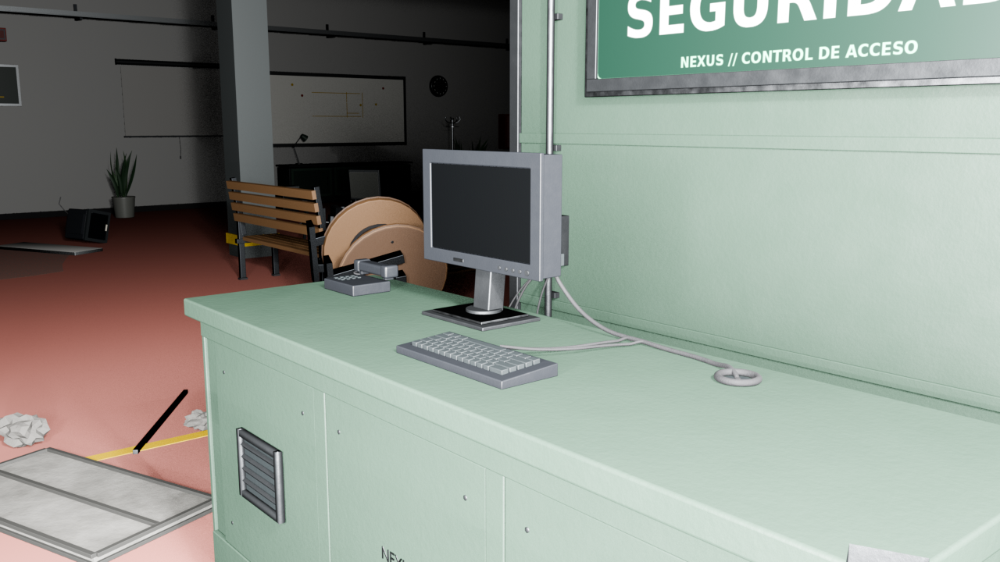

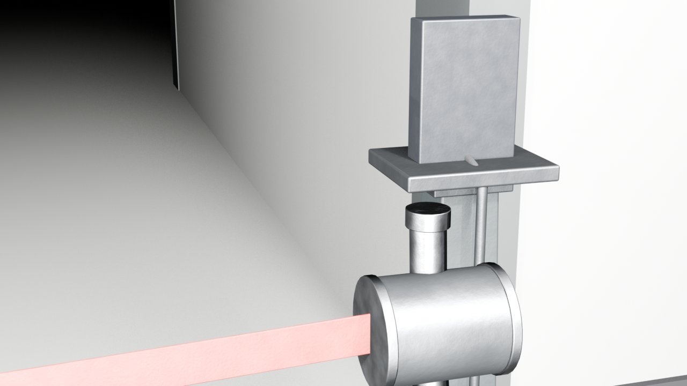

### 3.2. Lo que el hero todavía no cumple

- **No tiene capa de suciedad universal.** El estándar 19.2.D exige AO + ColorRamp + mezcla de polvo en todos los objetos abandonados. El checkpoint está limpio, alineado y con superficies perfectas; el desgaste vive en las texturas, no en la geometría.
- **Los charcos son agujeros negros.** `M_HERO_Water` tiene base 0,006/0,008/0,010, roughness 0,28, sin transmisión y sin raytracing. En EEVEE se leen como recortes, no como agua.
- **Cinco pares de geometría coincidente, en tres familias.** `KIT_HERO_SEC_Cable_Keyboard` y `PROP_HERO_SEC_Keyboard_Cable` son la misma pieza en el mismo sitio; `KIT_HERO_SEC_Partition_VentBack`/`VentFrame` y `KIT_HERO_SEC_Counter_VentBack`/`VentFrame` comparten bbox; `PROP_HERO_SEC_Intercom_Cradle_L`/`HandsetEar` y `Cradle_R`/`HandsetMouth` también. Hay z-fighting potencial.
- **El lector de tarjetas está construido como piezas separadas que no se tocan.** El gate detecta base, columna y cuerpo como flotantes; en el render se lee como un pedestal flotante.
- **No hay polvo, arañazos geométricos ni paneles desalineados.** El estándar pide que ningún objeto abandonado esté perfectamente alineado.

Conclusión: el checkpoint es el **mínimo aceptable** para un primer plano, no el máximo. La biblioteca debe fijar ese nivel de densidad y añadir la capa de abandono que aún falta.

---

## 4. Auditoría de objetos

Criterios de severidad:

- **Crítico:** no se puede usar en biblioteca sin rehacer geometría o sistema; bloquea la entrega.
- **Alto:** la silueta o el material fallan a distancia de juego; requiere corrección localizada.
- **Medio:** asset válido como base, pero necesita desgaste, UV, LOD o ajuste de pivote.
- **Bajo:** reutilizable con cambios menores o ninguno.
- **Oculto/legado:** duplicado antiguo; no instanciar.

Nota: en las tablas, “UV” es el **área UV medida** en unidades², no un porcentaje. Cuando aparece “100 % solapada” es el resultado del gate `qa_check`.

### 4.1. Emergencias y señalización

| Objeto / grupo | Colección | Tris / verts | Dimensiones (m) | Mat. | UV | Mods. | Indicios y defectos | Sev. | Decisión |
|---|---|---:|---|---:|---|---|---|---|---|
| `KIT_PILOT_Z10_Emergency_N` / `_E` | `L1_KIT_PILOT` | 2.144 / 1.098 c/u | 0,16 × 0,30 × 0,51 | 2 | Sí, 0,81 | 0 | Buena caja biselada, lente y conducto; lente roja **sin pictograma ni texto**; montaje de varilla única, sin escuadra de pared; QA game: 5 islas invertidas, UV 100 % solapada | Medio | Mejorar |
| `KIT_PILOT_Z10_Emergency_Ceiling` | `L1_KIT_PILOT` | 120 / 64 | 0,34 × 0,22 × 0,18 | 2 | Sí, 1,71 | 0 | Misma familia que REC01; caja con lente, sin jaula ni marco; copia de malla independiente | Medio | Fusionar / mejorar |
| `KIT_REC01_Emergency_Ceiling_0` / `_1` | `L1_RECEPTION_R1` | 120 / 64 c/u | 0,34 × 0,22 × 0,18 | 2 | Sí, 1,71 | 0 | Duplicado exacto del anterior; dos mallas separadas | Medio | Fusionar |
| `KIT_REC03_Emergency_Extraction` / `_Decon` | `L1_RECEPTION_R3` | 60 / 32 c/u | 0,35 × 0,14 × 0,22 / 0,30 × 0,14 × 0,18 | 1 | Sí | 0 | Caja de 32 vértices, sin bisel, sin lente emisiva, sin luz; no se lee como emergencia | Crítico | Rehacer / fusionar |
| `DET_REC03_Emergency_Decon_Lens` | `L1_RECEPTION_R3` | 60 / 32 | 0,22 × 0,02 × 0,10 | 1 | Sí | 0 | Plano rojo sin profundidad; no hay material emisivo | Crítico | Descartar / fusionar |
| `R21A_FIX_Emergency_N` / `_E` | `L1_SECURITY_R21A_FIXTURES` | 876 / 456 c/u | 0,39 × 0,22 × 0,29 | 5 | Sí, 0,74 | WN | Buen housing con 5 materiales; lente roja lisa; **la bandeja CCTV lo tapa**; QA: 1 isla invertida, 8 pares z-fighting | Medio | Mejorar |
| `R21D_FIX_Emergency_Checkpoint` | `L1_SECURITY_R21D_HERO_FIXTURES` | 368 / 192 | 0,28 × 0,17 × 0,18 | 3 | Sí | 0 | Compacto, emisivo rojo, sin gráfico; QA pasa geometría; punto más bajo local z=3,155 (montaje en pared) | Bajo | Reutilizar tal cual |
| `R21B_SERV_EmergencyW1` / `W2` / `S` | `L1_SECURITY_R21B_CIRCULATION` | 320 / 168 c/u | 0,30 × 0,27 × 0,22 | 3 | Sí | WN | Buen aplique de pared; sin circuito ni conducto visible; QA pasa geometría | Medio | Reutilizar / mejorar |
| `KIT_SEC02_EmergencyHousing` + `DET_SEC02_EmergencyLens` | `L1_SECURITY_R2` | 12 / 8 c/u | 0,32 × 0,12 × 0,20 | 1 | 4 caras UV cero | 0 | Cajas de 8 vértices, ocultas; versión antigua | Oculto | Descartar |
| `KIT_PILOT_Z10_EmergencyConduit_N` / `_E` | `L1_KIT_PILOT` | 1.812 / 928; 624 / 320 | 7,93 × 0,18 × 1,17; 0,15 × 0,14 × 0,47 | 2 | Sí, 5,58 / 0,94 | 0 | Buen recorrido en L; sin cajas de unión, sin expansión, sin abrazaderas intermedias; el tramo N pasa sobre la puerta | Medio | Mejorar |

**Lectura:** hay tres generaciones mezcladas. La buena es Z10/R21D/R21B; la mala es REC03 (caja plana) y el legado KIT_SEC02. No tiene sentido mantener cuatro carteles distintos: la biblioteca debe quedarse con **tres tipos canónicos** (pared con pictograma, techo con lente, baliza de pasillo) y variantes de estado (encendido / muerto / roto).

### 4.2. Las 7 luminarias de techo de Seguridad

| Objeto | Colección | Tris / verts | Dimensiones (m) | Material | UV | Mods. | Defecto | Sev. | Decisión |
|---|---|---:|---|---|---|---|---|---|---|
| `KIT_SEC01_CeilingLightHousing_0..6` | `L1_SECURITY_R1` | 60 / 32 c/u | 1,50 × 0,45 × 0,08 | `M_FM_Metal_Panel` | Sí, 5,97 | 0 | 7 copias de una caja achaflanada; sin marco, sin reflector, sin rejilla, sin tapa de acceso; tornillos inexistentes | Crítico | Rehacer hero / fusionar |
| `DET_SEC01_CeilingLightPanel_0..6` | `L1_SECURITY_R1` | 12 / 8 c/u | 1,35 × 0,32 × 0,02 | `M_FM_Steel_Dark` | Sí, 6,00 | 0 | **Panel de acero, no difusor**; sin emisión, sin prismas, sin borde; 7 copias | Crítico | Rehacer hero / fusionar |
| `LIGHT_SEC01_Ceiling_0..6` | `L1_SECURITY_R1` | — | — | Point, 0 W | — | — | 7 luces ocultas con energía 0; apagadas **por diseño** según `FM_SECURITY_R2.md`; no hay luz general | Crítico (fixture) | Rehacer rig |
| Distribución | — | — | 7 unidades en 884 m² | — | — | — | Posiciones (-101,5/13), (-88/13), (-74,5/13), (-101,5/31), (-88/31), (-74,5/31), (-88/21); separación 13,5–18 m; ~1 luminaria por 126 m² | Crítico | Recalcular |

**Importante:** el apagado es intencional. No “arreglar” encendiendo las 7 luces sin dirección de arte. El problema es que **el asset no sirve ni como luminaria muerta**: es una caja con un panel de acero. Para la biblioteca se necesita una familia con carcasa, marco embutido, reflector, difusor prismático, tornillos y dos variantes de emisión (muerta / encendida), más un rig de luz separado.

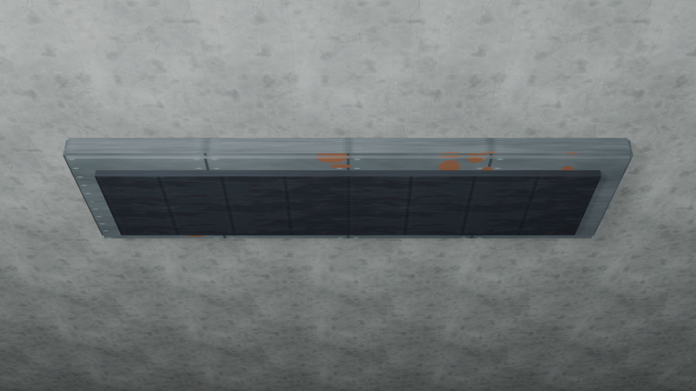

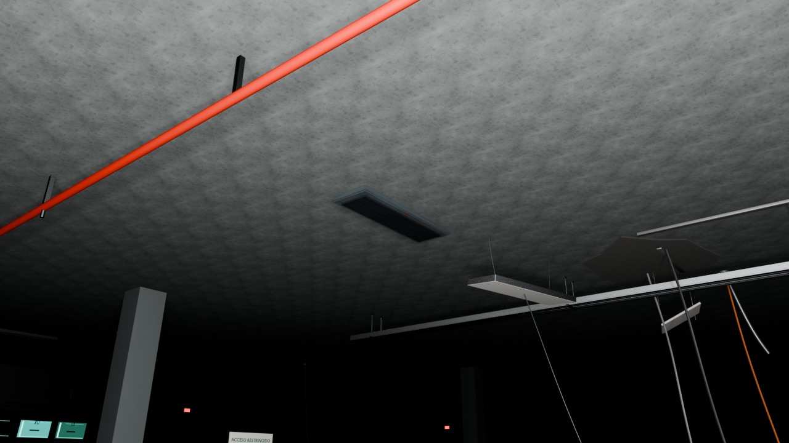

### 4.3. Puertas, marcos y vanos

Contexto: las hojas operables viven en Godot (`level1_doors.glb`, `fm_level1_door.gd`). El `.blend` contiene jambas, dinteles y algunas hojas estáticas. La auditoría separa **vano** (lo que se mide aquí) de **hoja** (lo que se prueba en Godot).

| Puerta / grupo | Colección | Geometría | Vano estructural / claro | UV | Defecto | Sev. | Decisión |
|---|---|---|---:|---|---|---|---|
| Seguridad N | `L1_ARCH_ZONES` | 3 cajas de 12 tri (`Door_N_L/R/T`) | 4,00 m estructural; 3,66 m entre jambas; 2,44 m alto | No | Hueco rectangular sin marco, sin architrave, sin umbral, sin sellos; el vano no coincide con el módulo 1,58×3,00 documentado | Crítico | Rehacer |
| Seguridad S | `L1_ARCH_ZONES` | 3 cajas de 12 tri | 6,00 m estructural; 5,68 m claro; 3,04 m alto | No | Igual; el checkpoint se ve a través del vano; no hay puerta ni marco | Crítico | Rehacer |
| Recepción N | `L1_ARCH_ZONES` + `L1_RECEPTION_R1` | 3 jambas + 2 cristales + 4 montantes + fascia + rótulo | 8,00 m estructural; 3,04 m alto | Jambas no; cristal sí | Cristal casi invisible, sin manillas, sin marco perimetral, sin umbral, sin sensor; se lee como un agujero | Crítico | Rehacer |
| Z10 E | `L1_KIT_PILOT` | 2 hojas 2,86×0,20×2,51, 720 tri c/u | 6,00 m estructural; 5,68 m dintel; 2,51 m alto | Sí, 68,6 | Hojas aparcadas a los lados, sin guía, sin cabecera, sin manillas, sin sellos; QA: 8 pares z-fighting | Alto | Mejorar |
| Kit genérico `SM_KIT_DoorFrame/Leaf` | `L1_KIT_ARCH` | 224 / 108 tri | 1,80×2,60 / 1,80×3,20 | Sí, 0,65–1,03 | Oculto; sin bisel, sin identidad, sin herrajes; no se usa en Seguridad | Oculto | Descartar |
| `LAB_DoorFrame/Leaf` | `L1_KIT_LAB` | 224 / 108 tri | 1,80×2,60 | Sí | Mismo kit genérico; fuera del nivel | Oculto | Descartar |
| `R21B_CIRC_GlassDoor` | `L1_SECURITY_R21B_CIRCULATION` | 856 tri, 464 v | 1,17×0,15×2,30 | Sí, 6,74 | Buen marco, bisagras y manilla; cristal lechoso/opaco; QA: 3 islas invertidas, pieza flotante, 8 vértices duplicados | Medio | Mejorar |
| `R21C_HATCH_Shutter` / `Counter` / `WindowFrame` | `L1_SECURITY_R21C_HERO_HATCH` | 7.504 / 6.892 / 3.692 tri | 0,78×1,95×2,35 el conjunto | Sí | Buen detalle (lamas, guías, manivela, mostrador, bisagras); QA: islas invertidas, 1 z-fighting; el mostrador negro y los fragmentos de cristal se leen como plástico | Bajo | Reutilizar tal cual |
| `R21A_RACK_Door` / `Frame` | `L1_SECURITY_R21A_RACK` | 3.320 / 8.940 tri | 0,83×0,85×2,03 | Sí | Buen rack con puerta, bisagras y placa; QA: 39 islas invertidas en el frame | Bajo | Reutilizar tal cual |

**Hallazgo dimensional:** los vanos de Seguridad (4,0 m y 6,0 m) y recepción (8,0 m) no son puertas de 1,58 m. Si son **portales abiertos**, deben renombrarse y no llevar hoja; si son **puertas**, el vano debe reducirse o justificarse como puerta doble/telescópica. La decisión afecta a la biblioteca, a la navegación y a las criaturas. No se debe modelar una hoja nueva hasta que esa decisión esté aprobada.

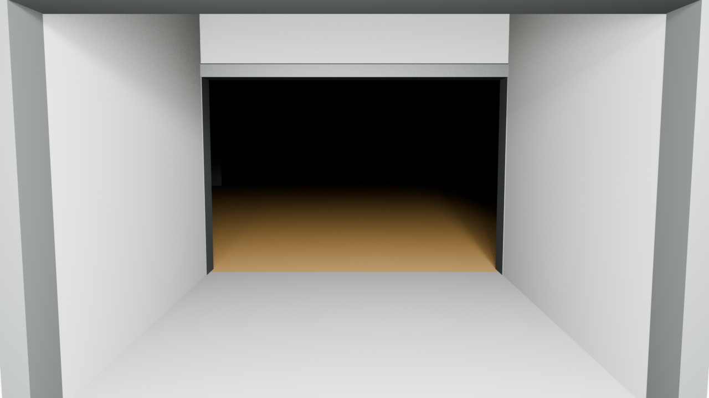

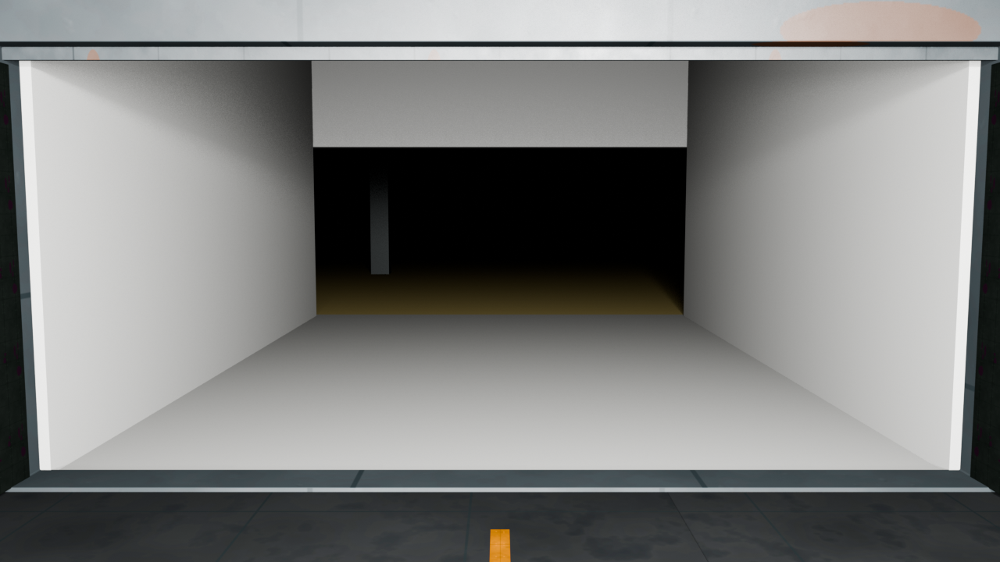

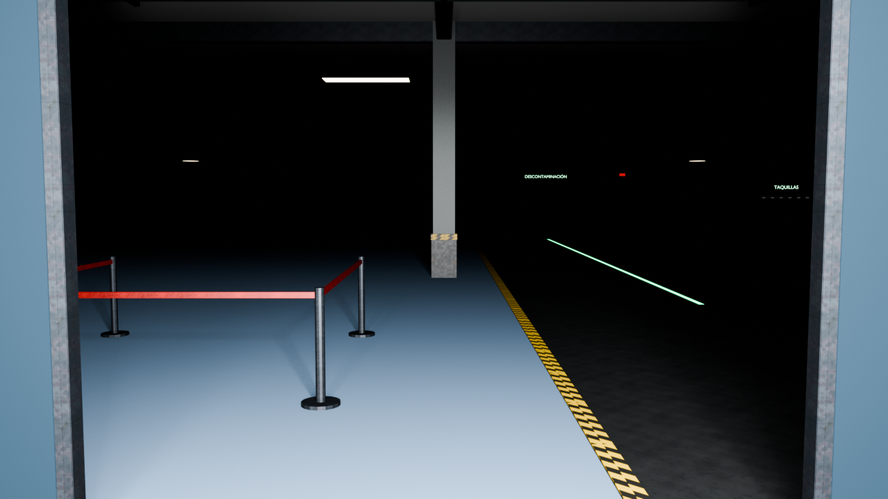

### 4.4. Taquillas, mobiliario y equipamiento

| Familia | Objetos | Tris | Dimensiones | Materiales / UV | QA y defectos | Sev. | Decisión |
|---|---:|---:|---|---|---|---|---|
| Taquillas Z10 (`PROP_Z10_LockerBank`, `LockerDoor_00..02`, hardware, vents, labels) | 17 | 3.048 | Banco 0,55×1,50×1,95 | 1–2 mat.; UV 9,61 banco, 1,80 puerta | Limpio, puertas planas, sin bisagras ni cerraduras, sin desgaste; QA pasa geometría, UV 100 % solapada; pivote bajo | Alto | Mejorar |
| Taquillas R21C (`R21C_LOCK_BankA/B`) | 2 | 190.584 | 1,01×4,41×1,98 c/u | 11 mat.; UV 82,4 | **Hero visual**: rejillas, bisagras, cerraduras, puertas abiertas, interior, números; **95.292 tri c/u, 600 n-gons, 719 islas, 234 islas invertidas, 99 z-fighting, UV 100 % solapada**. No es LOD0 de biblioteca sin limpieza | Medio | Mejorar (LOD) |
| Taquillas R21B ocultas (`R21B_LOCK_BankA/B` + `KeyCabinet`/`Shelving`) | 4 | 15.140 | 1,01×4,40×1,98 los bancos | 8 mat.; UV 55,9 | Versión antigua simplificada; oculta; sirve como LOD2 si se limpia | Oculto | Fusionar (LOD2) |
| Taquillas recepción (`PROP_REC02_Locker_*`) | 35 | ~2.100 | 2,40×0,48×1,90 el cuerpo | 1 mat. plana; UV 5,73 puerta | Seis puertas de 32 vértices, sin marco, sin bisagras, sin cerradura, sin profundidad; etiqueta blanca plana; QA pasa geometría pero UV 100 % solapada; punto más bajo local z=0,075 | Crítico | Rehacer hero |
| Escritorio recepción (`PROP_REC02_Desk_*`) | 5 | 300 | 4,20×0,85×0,90 | 1 mat. plana; UV 30,57 | Cajas de 32 vértices, sin bisel, sin canto, sin cableado, sin cajones; tablero con veta de madera en líneas topográficas por densidad UV | Crítico | Rehacer hero |
| Sillas recepción (`PROP_REC02_Chair_*`, Bench) | 12 | ~720 | 0,50×0,50×0,95 | 1 mat. plana | Asiento, respaldo y cuatro patas cúbicas; sin curvatura, sin costura, sin desgaste | Crítico | Rehacer hero |
| Monitores recepción (`PROP_REC02_Monitor_*`) | 12 | ~720 | 0,58×0,05×0,36 | 1–2 mat. planas | Marco, pantalla y peana cúbicos; pantalla sin bisel ni reflejo; teclado caja | Crítico | Rehacer hero |
| Checkpoint hero (mostrador, monitor, teclado, lector, barrera) | 158 | 35.082 | 6,4×4,2×2,5 | 19 mat.; UV 158/158 | Listón; QA detecta lector flotante, 5 pares duplicados, n-gons, agua negra | Bajo | Mejorar (base) |
| Puestos R21A (`R21A_WS_*`, `R21A_CHAIR_*`) | 31 | 116.682 | 2,12×0,82×0,79 escritorio | 12 mat. escritorio; UV 13,75 | Escritorio, monitores, teclado, radio, teléfono, ratón y PTZ detallados; **sillas de 9.248 tri con silueta de caja**; QA: 16+10+24 islas invertidas, UV 93–100 % solapada | Medio (sillas alto) | Reutilizar escritorio; rehacer sillas |
| Briefing R21B (`R21B_BRIEF_*`) | 24 | 38.120 | Mesa 3,07×1,22×0,80 | 5–8 mat.; UV 20–22 | Mesa con estructura en T y cableado, pero tablero plano sin bisel; 8 sillas de 2.256 tri con respaldo rectangular; QA: islas invertidas, 142 back-to-back, UV 100 % solapada | Alto | Rehacer mesa/sillas; reutilizar credenza/proyector |
| Estantería y llavero R21C (`R21C_SHELF_Unit`, `R21C_KEYS_KeyRack`) | 2 | 56.144 | 0,70×2,39×2,52 / 0,16×0,95×0,95 | 12 mat.; UV | Muy buen detalle visual (X-bracing, agujeros, llaves con etiquetas); QA: 50/58 islas invertidas, 272/122 z-fighting, UV 100 % solapada | Bajo | Reutilizar tal cual (limpiar QA) |
| Cart R21C (`R21C_CART_ToolCart`) | 1 | 21.184 | 0,82×0,68×1,01 | 10 mat.; UV 13,76 | Caja con asas y ruedas; 21k tri para una forma simple; 70 n-gons, 26 islas invertidas, 12 z-fighting | Alto | Mejorar (decimar) |
| Lector de tarjetas canónico (`PROP_HERO_SEC_Reader_*`) | 17 piezas | ~500 | 0,34×0,28×1,00 | 1–2 mat.; UV | Buen detalle (base, columna, cuerpo, ranura, LED, conducto, abrazaderas); las piezas no se tocan entre sí (QA flotante) | Bajo | Reutilizar tal cual (unir) |

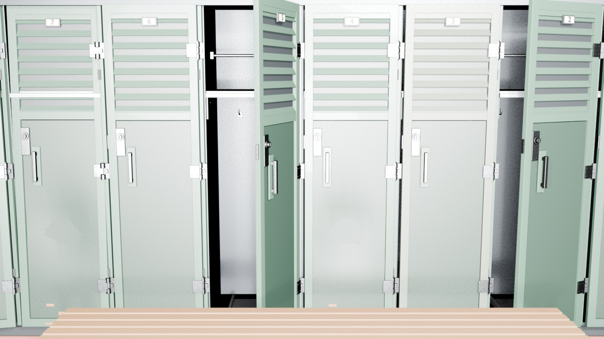

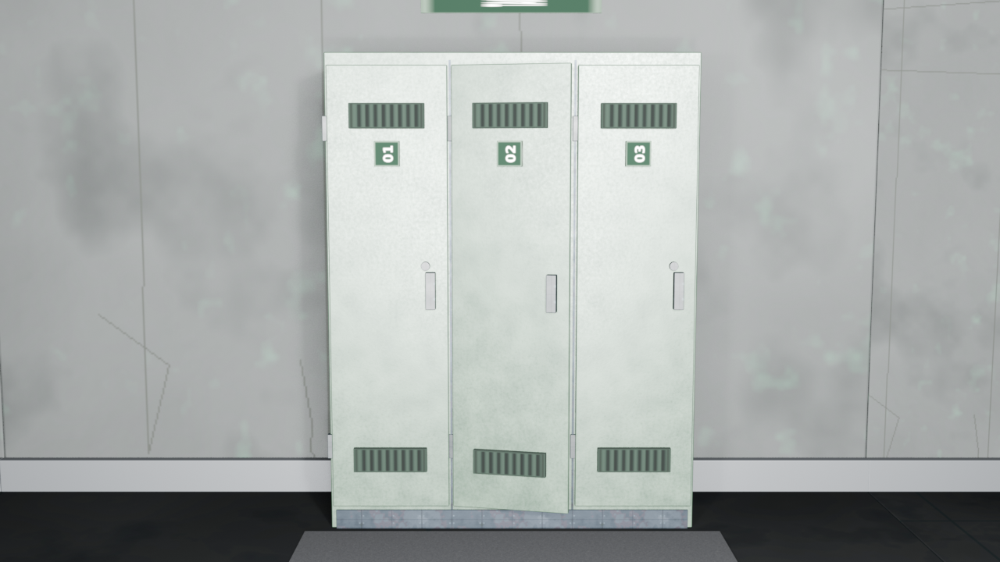

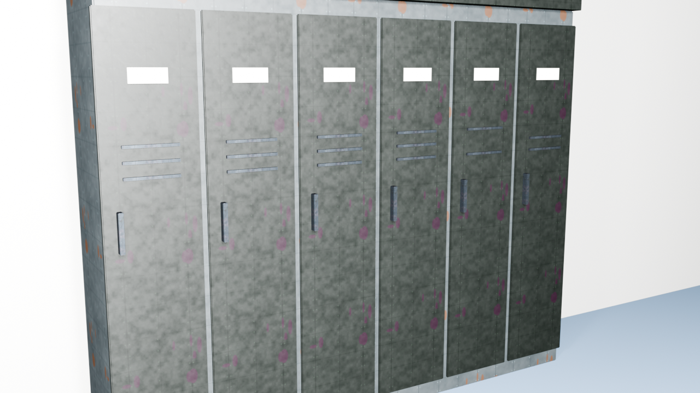

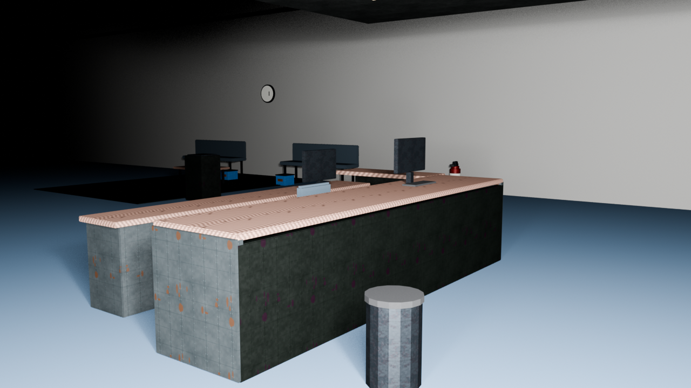

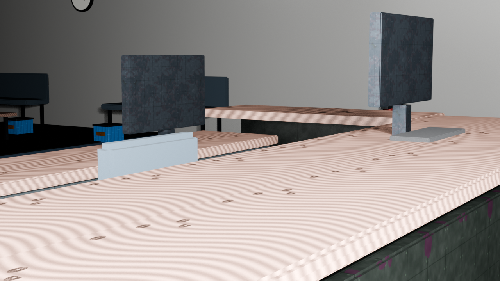

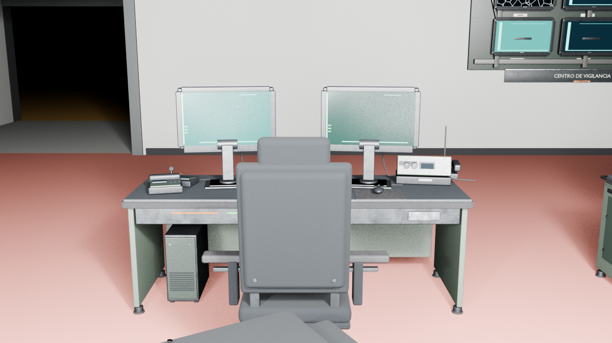

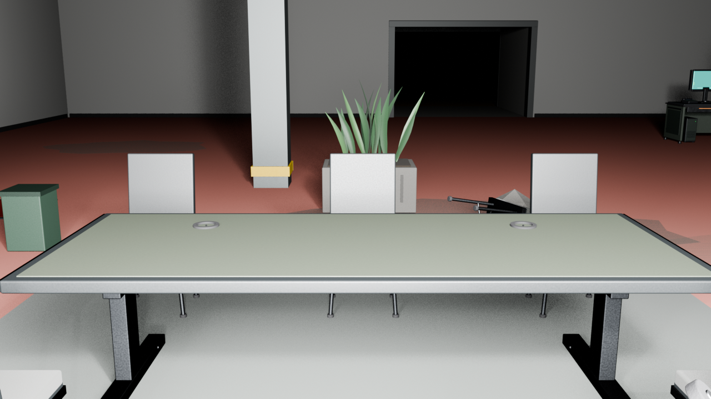

### 4.5. Barreras, stanchions, bins, crates, barriles, reels y carts

| Familia | Objetos | Tris | Materiales / UV | Defecto | Sev. | Decisión |
|---|---:|---:|---|---|---|---|
| Barreras y stanchions recepción (`PROP_REC02_Barrier_*`, `Stanchion_*`, `Belt_*`) | 13 | 44–60 c/u | 1 mat. plana; UV 0,87–2,60 | Poste cuadrado de 12 cm, cintas de 3 cm × 5 cm como cajas rígidas, cruces a alturas distintas, sin tensores ni bases reales; en render las cintas se atraviesan | Crítico | Rehacer hero |
| Papeleras recepción (`PROP_REC02_Bin`) | 2 | 120 | 1 mat. | Caja de 32 vértices; sin bolsa, sin tapa, sin pedestal | Crítico | Rehacer / fusionar |
| Tool carts Z10/REC05 (`PROP_Z10_ToolCart`, `PROP_REC05_ToolCart`) | 2 | 2.008 | 3 mat.; UV 3,85 | Buen carro con cajones, tiradores, bandejas y ruedas; QA game pasa; ruedas tipo puck sin horquilla; UV 100 % solapada | Bajo | Reutilizar tal cual |
| Storage cart Z10 | 1 | 1.848 | 3 mat.; UV 6,37 | Buen carro de estantes; mismos puck wheels | Bajo | Reutilizar tal cual |
| Cable reels Z10/REC05 (`PROP_Z10_CableReel_0/1`, `PROP_REC05_CableReel`) | 3 | 2.032 c/u | 3 mat.; UV 4,59 | Buena estructura de madera/metal; **sin cable enrollado**, tambor vacío; QA pasa geometría | Medio | Mejorar (cable) |
| Large cable drum Z10 | 1 | 1.940 | 3 mat.; UV 9,37 | Buen tambor de 1,4×1,2×1,3; sin cable | Medio | Mejorar |
| Crates Z10/REC05 (`PROP_Z10_WoodCrate_0..2`, `PROP_REC05_Crate_0/1`) | 5 | 1.860 c/u | 1 mat.; UV 23,95 | Buena caja de madera con listones; sin etiquetas, sin flejes, sin desgaste | Bajo | Reutilizar tal cual |
| Barriles Z10 (`PROP_Z10_Barrel_0..3`) | 4 | 2.688 c/u | 1 mat.; UV 0,50 | Buen barril plástico con aros y tapas; **demasiado limpio y brillante**, cuatro copias idénticas; punto más bajo local z=0,2, pivote no está en la base | Medio | Mejorar |
| Spill pallet Z10/REC05 | 2 | 1.968 | 2 mat.; UV 30,59 | Buena rejilla y marco; limpio | Bajo | Reutilizar tal cual |
| Pallet Z10/R21D | 3 | 1.620–1.780 | 2 mat.; UV 4,88–35,19 | Buena estructura de madera; UV solapada; QA pasa | Bajo | Reutilizar tal cual |
| Utility cabinet Z10/REC05 | 2 | 6.268 | 1 mat.; UV 0,66 | Buen detalle de puerta y bisagras; **938 aristas de borde (malla abierta)** en el barrido; QA game pasa con duplicados y 143 back-to-back; colocación embedded en pared en recepción | Alto | Mejorar / no instanciar hasta corregir |
| Bins Z10/REC05/R21B | ~14 | 324 / 212 | 2–3 mat. | Buena forma tapered; sin bolsa, sin tapa articulada, sin suciedad | Medio | Reutilizar / mejorar |
| R21C cart | 1 | 21.184 | 10 mat.; UV 13,76 | Caja con asas y ruedas; 70 n-gons, 26 islas invertidas, 12 z-fighting | Alto | Mejorar (decimar) |
| Cable reels R21B chaos | 2 | 5.460 c/u | 5 mat.; UV 8,69 | Buen detalle de tambor y cable; 36 n-gons; QA no ejecutado | Bajo | Reutilizar tal cual |
| Crate R21B chaos | 1 | 188 | 1 mat. | Caja de 96 vértices; sin bisel, sin listones | Medio | Mejorar / sustituir por crate Z10 |
| Conos R21D | 2 | 392 c/u | 2 mat. | Cono y base correctos; sin desgaste | Bajo | Reutilizar tal cual |
| `R21B_CHAOS_DeadMonitorA` | 1 | 612 | 2 mat. | **Flota a z=0,87–1,26 sobre un pallet a z=0,16**; no hay soporte | Alto | Corregir colocación |

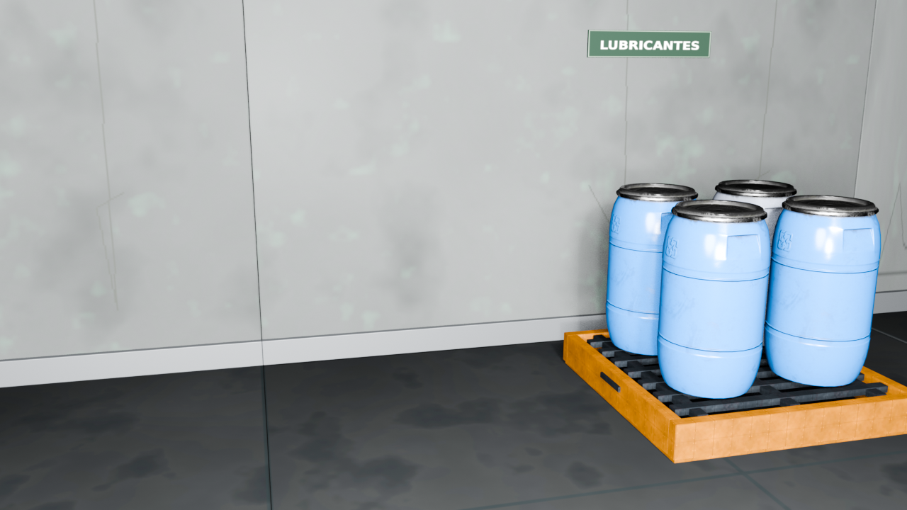

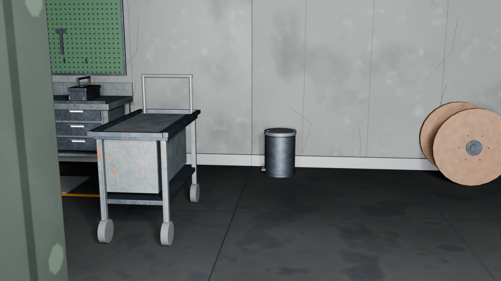

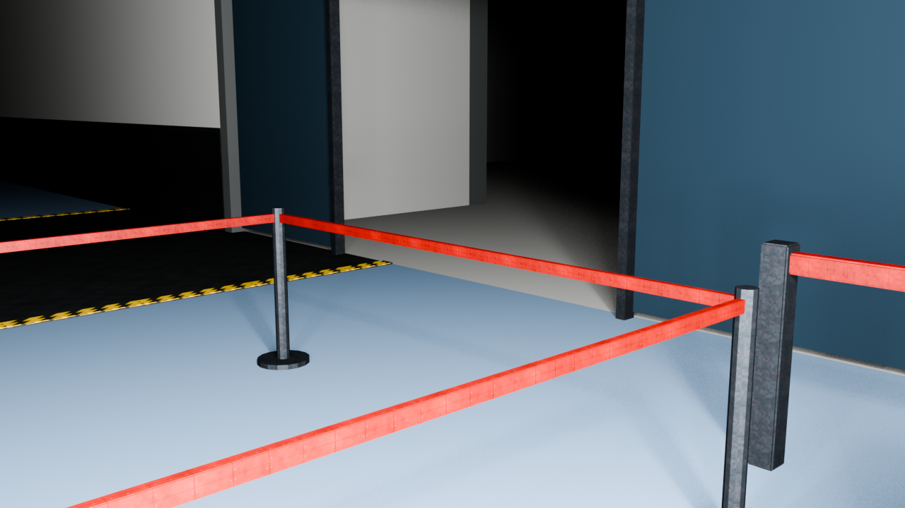

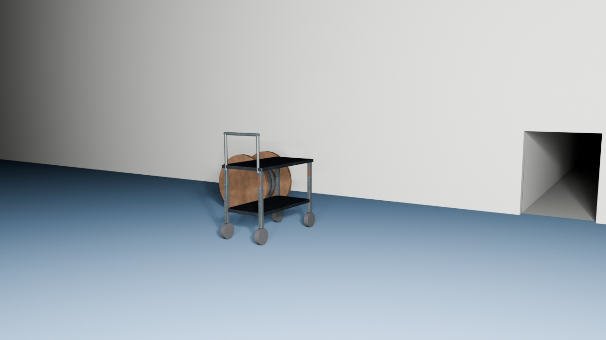

### 4.6. Shell de Seguridad

| Elemento | Objetos | Tris | UV | Material | Defecto | Sev. | Decisión |
|---|---:|---:|---|---|---|---|---|
| Suelo `SM_L1_Zone03_Security_Floor` | 1 | 12 | **No** | `M_L1_Zone_Security.010` plano (0,30/0,12/0,10) | Caja de 8 vértices; sin losa, sin juntas, sin desgaste; color granate que se lee salmón | Crítico | Rehacer hero |
| Muros N/S/E/W (10 cajas) | 10 | 120 | **No** | `M_L1_Wall_Blockout` plano (0,34) | Cajas de 12 tri; sin zócalo, sin junta, sin marco, sin grieta, sin pintura; el vano se corta con tres cajas | Crítico | Rehacer hero |
| Techo `SM_L1_Zone03_Security_Ceiling` | 1 | 12 | Sí, 7.168 | `M_FM_Concrete_Wall` (PBR) | Único elemento texturizado del shell; incoherente con muros planos; sin grid, sin registros, sin bandejas de acceso | Crítico | Rehacer hero |
| Columnas `SM_L1_Column_Security_*` | 4 | 48 | **No** | `M_L1_Column_Steel.010` plano | Cajas de 0,45×0,45×4,8; sin capitel, sin base, sin protección; bandas amarillas de R21B son un objeto aparte | Crítico | Rehacer hero |
| Jambas de puertas N/S | 6 | 72 | **No** | `M_L1_Door_Frame.010` plano (0,07) | Cajas de 0,16×0,36×2,44/3,04; sin marco, sin architrave, sin sellos | Crítico | Rehacer hero |
| Conector/vestíbulo de Seguridad | 4 | 48 | **No** | `M_L1_Wall_Corridor` / `M_L1_Ceiling_Blockout` | Cajas; el conector no tiene servicios ni techo registrable | Crítico | Rehacer hero |
| **Total shell** | **36** | **768** | **21 sin UV** | 3 materiales planos + 1 PBR | Sin bisel, sin capa de suciedad, sin escala de detalle | **Crítico** | **Rehacer hero** |

El shell es, con diferencia, el mayor bloqueador sistémico: 768 triángulos para 884 m². Cualquier prop hero que se coloque encima queda descontextualizado. La reconstrucción no requiere rehacer la planta: se conservan las dimensiones y la compartimentación, y se sustituyen las cajas por módulos de muro con zócalo, junta, panel, marco y desgaste.

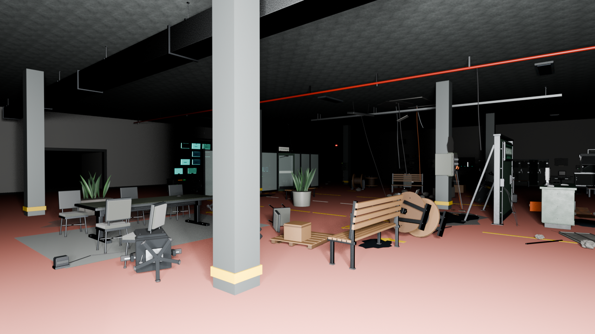

---

## 5. Servicios: inventario, mapa e incoherencias

### 5.1. Inventario por familia

| Familia | Objetos | Tris | Objetos de 8 vértices | Sin UV | Nota |
|---|---:|---:|---:|---:|---|
| Cables | 45 | 67.278 | 2 | 0 | Cables de hero/CCTV; alta densidad, no son infraestructura |
| Sprinklers | 19 | 15.216 | 0 | 0 | Incluye ramales y feeders de Z10 |
| Risers | 28 | 12.492 | 0 | 0 | Riser A/B de Z10, válvulas, manómetros, soportes |
| HVAC | 34 | 10.004 | 0 | 0 | Ductos y flanges; sin rejillas/difusores |
| Bandejas | 30 | 8.672 | 10 | 0 | Bandejas y soportes; 10 son cajas estiradas |
| Conductos | 26 | 5.208 | 9 | 0 | 9 de 26 son cajas de 8 vértices |
| Rejillas/ventilación | 34 | 3.384 | 6 | 0 | Rejillas de pared y ventilaciones de props |
| Soportes | 1 | 1.532 | 0 | 0 | `R21A_CCTV_Support` |
| Desagües/forros | 9 | 244 | 6 | 0 | Rejilla de suelo y pasamuros |
| **Total visible** | **226** | **124.030** | — | — | 228 con los 2 ocultos |

La fila “Cables” agrupa por familia y no incluye cables embebidos en bandejas o ductos; el filtro simple por nombre da 75.010 triángulos. Al excluirlos quedan **49.020 triángulos** de ductos, bandejas, sprinklers, risers y conductos: 38.476 en Z10, 2.448 en recepción y 8.096 en Seguridad. El corredor, los vestíbulos, las escaleras y el laboratorio: **0**.

### 5.2. Mapa de rutas por sala/pasillo

| Sector | Límites | HVAC | Bandejas eléctricas | Sprinklers | Otros | Estado |
|---|---|---|---|---|---|---|
| **Z10 / conector de servicio** | x 40–62; y 8–30; z 0–4,1 | 20 m, 0,8×0,6, 8 flanges, 8 hangers; sin difusores | Bandeja oeste 30,26 m + 5 soportes; cable trench 7,95 m + riser; bandeja este 16 m | 20 m principal + ramales/feeds + 5 cabezas + 5 hangers | Risers A/B de agua (3 tubos cada uno), válvulas y manómetros; conducto este 16 m con hueco de 6 m en puerta; 2 sleeves huérfanos; rejilla de suelo | **Parcial, la mejor base** |
| **Recepción** | x −110..−70; y −40..−8; z 0–5,2 | 36 m, 0,8×0,6, 9 flanges, **3 hangers**, sin difusores; termina a 2 m de los muros | Bandeja N 36 m + bandeja W 28 m; **4 hangers cada una**; sin risers | 38 m de un solo tubo; **0 cabezas**; 4 hangers | Ninguno | **Crítico / blockout** |
| **Seguridad** | x −105..−71; y 10–36; z 0–4,8 | 19,86 m, 0,68×0,87; sin difusores; 1 soporte; termina a 2,6/3,6 m de los muros | Bandeja central 12 m + bandeja oeste 18,5 m (sin soportes); bandeja CCTV 9,57 m con 1 soporte parcial; sin risers | 23,6 m de una sola línea; sin ramales; 0 hangers | 3 rejillas de pared desconectadas; armario de manguera; conductos de emergencia | **Crítico / incoherente** |
| **Corredor principal** | x −100..75; y −4..4; 174 m | 0 | 0 | 0 | 0 | **Ausente** |
| **Vestíbulo de recepción** | x −94..−86; y −8..−4 | 0 | 0 | 0 | 0 | **Ausente** |
| **Conector de Seguridad** | x −92..−86; y 4–10 | 0 | 0 | 0 | 0 | **Ausente** |
| **Escalera principal / E1 / E2** | — | 0 | 0 | 0 | 0 | **Ausente** |
| **Laboratorio** | x −184..−176; y −54..−46 | 0 | 0 | 0 | 0 | **Ausente** |

### 5.3. Registro de incoherencias

**Los seis fallos que resumen el estado:**

1. Recepción: cuatro tendidos rectos de 28–38 m, sin ramales, sin difusores, sin cabezas de sprinkler y con 3–4 hangers por tendido.
2. Seguridad: ducto y bandejas que terminan en el aire, tres rejillas de pared sin ducto y un solo ramal de sprinkler.
3. Z10: el conjunto más completo, pero con el conducto cortado 6 m en la puerta, cambio de sección cúbica a cilíndrica y dos sleeves huérfanos.
4. Corredor, vestíbulos, escaleras y laboratorio: cero servicios.
5. Sin patinillos ni distribución vertical: Z10, recepción y Seguridad son islas.
6. Sin pasamuros, firestop, dampers, registros ni pendientes de desagüe en ningún sector.

| ID | Sector | Incoherencia | Evidencia numérica | Sev. |
|---|---|---|---|---|
| S-01 | Recepción | El ducto HVAC termina en el aire antes de los muros, sin pasamuros, brida de pared ni compuerta | 36 m; extremos x −108 y −72; muros en −110 y −70; 2 m de separación; 3 hangers para 36 m; hueco máximo 24 m | Crítico |
| S-02 | Recepción | Bandejas N y W cortadas en el aire, sin riser ni panel | N 36 m, 4 hangers a 8 m; W 28 m, 4 hangers con huecos de 12 m y 8 m; extremos a 2 m de los muros | Crítico |
| S-03 | Recepción | Un solo tubo de sprinkler, sin cabezas ni ramales, para 1.280 m² | 38 m, 4 hangers, 0 cabezas; cobertura 0 % | Crítico |
| S-04 | Recepción | El HVAC no tiene rejillas de suministro ni retorno; no hay difusores en ninguna sala | 0 difusores en 36 m; 0 rejillas de retorno | Crítico |
| S-05 | Seguridad | El ducto HVAC termina en el aire, sin difusores ni compuertas | 19,86 m; extremos y 13,6 / 33,4; muros en 10 / 36; 1 soporte; 0 difusores | Crítico |
| S-06 | Seguridad | Las 3 rejillas de pared no conectan con nada | W en x −104,8; S en y 10,2; E en x −71,1; ducto en x −97,2; distancia 7,7–26 m; espesor 0,08 m, sin ducto detrás | Crítico |
| S-07 | Seguridad | Bandejas central y oeste cortadas, sin soportes ni risers | 12 m y 18,5 m; extremos y 12,6/24,6 y 13/31,5; 0 soportes dedicados; 0 risers | Crítico |
| S-08 | Seguridad | Un solo ramal de sprinkler para 884 m², sin grid ni cabezas distribuidas | 23,6 m en x −90,7; 0 ramales; 0 hangers; cubre solo la franja central | Crítico |
| S-09 | Seguridad | La bandeja CCTV no conecta con la bandeja central; la señal de emergencia queda tapada | CCTV 9,57 m en y 35,5; central 12 m en x −84,5; 10,9 m de separación en Y; la bandeja cruza la señal R21A a z 3,6–4,78 | Alto |
| S-10 | Z10 | El ducto HVAC termina antes de los muros; las “wall connections” no tienen brida visible | 20 m; extremos x 40,5 / 60,5; muros 40 / 62; 0,5 / 1,5 m; 0 difusores | Alto |
| S-11 | Z10 | El conducto este cambia de sección y tiene un hueco de 6 m en la puerta | 5 tramos: 4 de 8 vértices (caja cuadrada) y 1 de 216 vértices (cilindro); 6 m sin conducto entre y 18 y 24; sin cajas de unión | Alto |
| S-12 | Z10 | Dos sleeves huérfanos | x 61,8; y 11,9 y 25,9; z 2,54–2,66; diámetro 0,12; ningún tubo los atraviesa | Medio |
| S-13 | Z10 | La bandeja oeste atraviesa los muros extremos sin sleeve; soportes insuficientes | 30,26 m; 5 soportes; hueco máximo 9 m; atraviesa y 4,7 y 34,9; muros en 8 y 30 | Alto |
| S-14 | Z10 | Las cabezas de sprinkler están solo en el ramal y 17; los ramales y 9–29 no tienen cabezas | 5 cabezas para 484 m²; separación 4 m; cobertura 1/97 m² | Alto |
| S-15 | Z10 | Los risers A/B nacen en el suelo sin placa ni sleeve; el tubo atraviesa la losa sin escusón | 3 tubos de 4 m por riser; base z 0; techo z 3,99; sin placa de piso; sin etiqueta de válvula | Medio |
| S-16 | Z10 | Densidad de texel inconsistente en bandejas y conductos | 251–290 px/m en tray/conduit vs 1.024 px/m en HVAC/tray de recepción | Medio |
| S-17 | Global | Corredor, vestíbulos, escaleras y laboratorio sin servicios | 174 m de corredor; 0 objetos de servicio | Crítico |
| S-18 | Global | No hay distribución vertical ni patinillos que conecten Z10, recepción y Seguridad | 0 shafts; 0 risers fuera de Z10; cada sala es una isla | Crítico |
| S-19 | Global | Duplicados y legado desconectados | 33 objetos ocultos; 21k tri de R21B lockers/hatch/toolcart + R2 + KIT_ARCH | Bajo |
| S-20 | Z10 | Rejilla de suelo plana, sin pendiente ni tubería | Grate 0,40×0,40×0,012 a z 0,01; sin depresión; sin tubo | Bajo |
| S-21 | Recepción | La línea de wayfinding no llega al deck de extracción | 17 m de y −33 a −16; el deck empieza en y −35; 2 m sin línea hasta el deck y 7 m hasta el rótulo de y −39,9 | Medio |
| S-22 | Global | Cruces de muro sin sleeve ni firestop | Z10 tray en y 8/30; ductos de recepción cerca de muro; ducto de Seguridad sin penetración | Alto |
| S-23 | Global | No hay coordinación de cotas entre ducto, bandeja, sprinkler y luminaria | Z10: ducto 3,25–3,85, bandeja 3,0, sprinkler 3,87, techo 3,99; Seguridad: ducto 3,84–4,71, techo 4,7; sin cámara de acceso | Medio |
| S-24 | Global | Sin compuertas cortafuego, dampers, válvulas de prueba ni registro sistemático | 0 fire dampers; 0 test drain; 1 panel de acceso visible en Z10; sin registros en recepción/Seguridad | Alto |
| S-25 | Global | Sin pendientes de desagüe ni sumideros conectados | 1 rejilla de suelo; 0 pendientes; 0 stack | Medio |

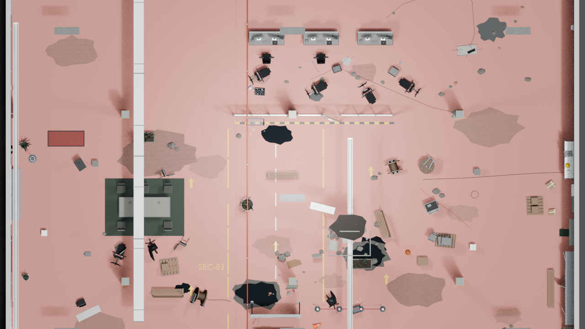

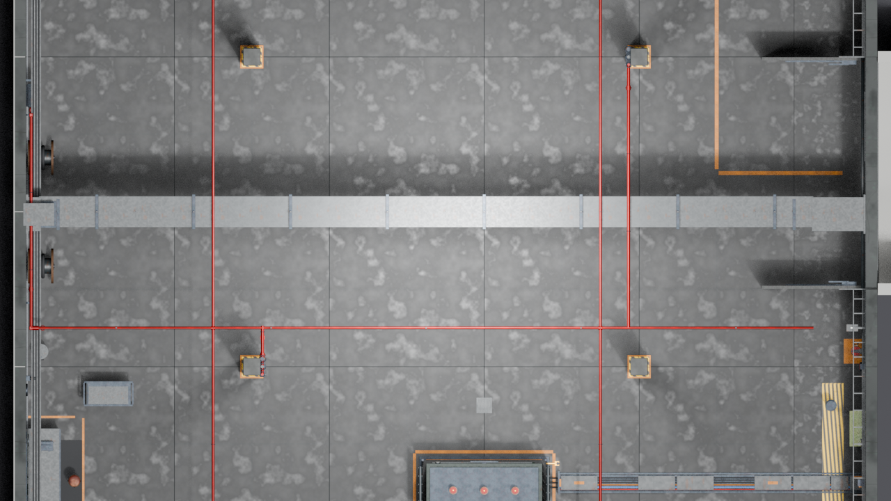

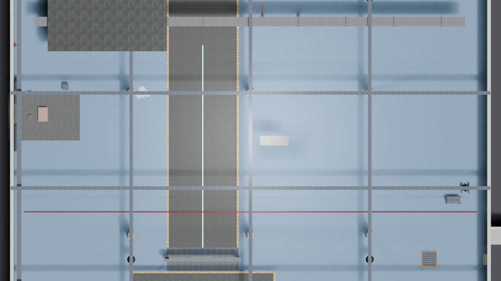

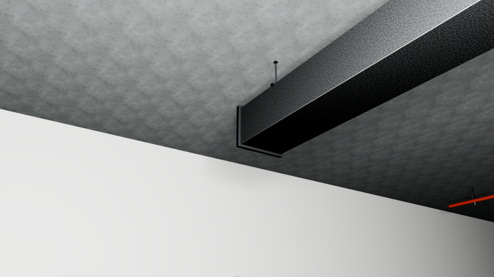

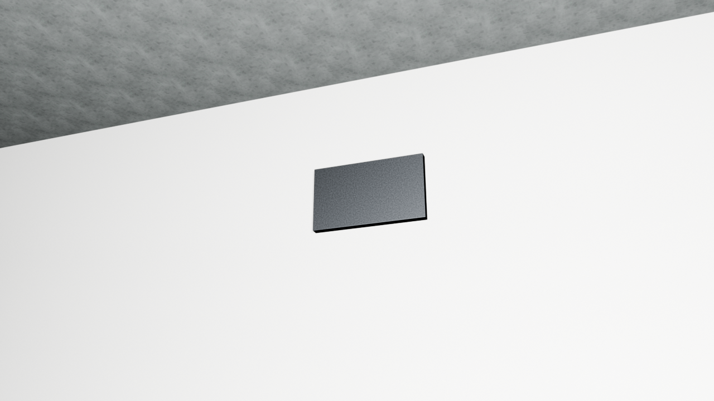

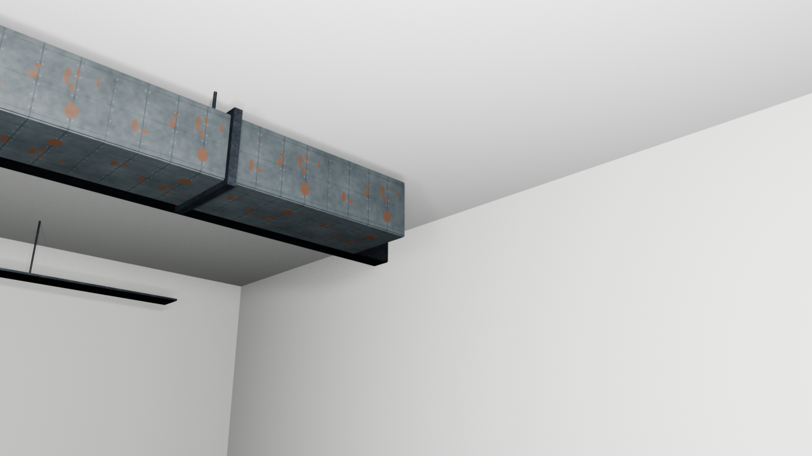

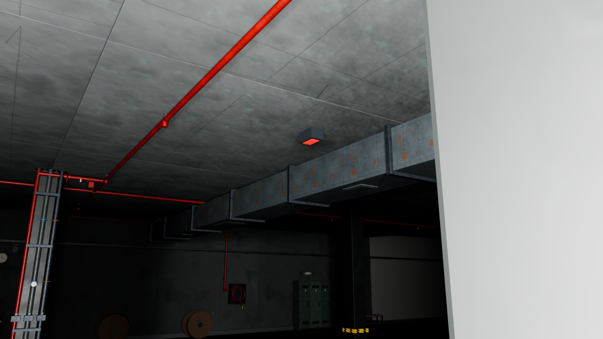

### 5.4. Esquema coherente propuesto

> Propuesta de diseño, no implementada. No define la activación de la extracción ni sustituye la recepción del nivel 1 como punto establecido.

#### Principio de continuidad

Cada servicio debe empezar y terminar en un **nodo físico**: shaft, riser, equipo, rejilla, difusor, válvula o pasamuros. No se acepta un extremo con tapa ciega en el aire. Las transiciones entre secciones se resuelven con **reducción, brida o codo**, nunca con un salto de sección o material.

#### Distribución por sector

| Sector | HVAC | Bandejas eléctricas | Sprinklers | Otros |
|---|---|---|---|---|
| **Z10 / sala de máquinas** | AHU + ducto principal 0,8×0,6; ramales a corredor, recepción y Seguridad; difusores en cada ramal | Bandeja principal 0,4 m; bandejas de 0,3 m a cuadros; riser a cada planta | Válvula principal, manifold, test drain, flow switch; 100 mm | Riser A/B de agua; desagüe con pendiente 2 %; sumidero |
| **Corredor principal** | Espina 175 m a z 4,1–4,5; ramal cada 10–12 m; difusores 0,6×0,6 cada 8 m | Espina 0,4 m a z 3,9; derivaciones a cada sala; separación 300 mm de sprinkler | Espina 100 mm a z 4,3; cabezas cada 3,5–4 m en las ramas | Sleeves y firestop en cada muro; registros de acceso |
| **Recepción** | Ramal desde corredor en x −90; 12 difusores; retorno junto a puertas | 2 derivaciones; bandeja al desk y a decon; riser al cuadro | 18 cabezas en 3 ramales; cobertura 1/35 m² | Desagüe en decon; wayfinding continuo hasta extracción |
| **Seguridad** | Ramal desde conector en x −89; ducto principal en x −97; 8 difusores; rejillas de retorno | 3 derivaciones: centro, lockers, CCTV; riser al rack | 16 cabezas en 2–3 ramales; cubrir briefing, lockers y ops | Conectar las 3 rejillas de pared con ductos cortos o sustituirlas por difusores de techo |
| **Oficinas / almacén / mantenimiento** | 1 ramal cada uno; 4–6 difusores | 1 bandeja + cuadro | 1 ramal + 8–10 cabezas | Sleeves en muros |
| **Escaleras / vestíbulos** | Extracción de humo o ventilación de escalera | Bandeja de emergencia | Cabezas en rellanos | Luz de emergencia con circuito |
| **Laboratorio** | Ramal dedicado; extracción local | Bandeja + cuadro | 4–6 cabezas | Desagüe químico |

#### Cotas de coordinación

Para una altura libre de 3,0 m (corredor estándar) y techo a 4,8 m:

- Ducto HVAC: cara inferior ≥ 3,9 m; 0,5–0,6 m de canto; hangers cada 2,5 m.
- Bandeja eléctrica: 3,7–3,9 m; 0,3–0,4 m de ancho; soportes cada 2 m; 300 mm de separación del sprinkler.
- Sprinkler: main a 3,6–3,8 m; cabezas a 3,5–3,7 m; ramales cada 4 m.
- Luminarias: 4,5–4,6 m, fuera del plano de los difusores.
- Registros y dampers: acceso desde techo registrable; no ocultar tras el ducto.
- En Z10 (techo 4,1 m), comprimir: ducto 3,3–3,7; bandeja 3,05–3,15; sprinkler 3,85–3,95; luminarias 3,9.

#### Reglas de biblioteca de servicios

1. Módulos rectos de 2, 3 y 4 m; codos, tes, reducciones, bridas y tapas ciegas solo en nodos.
2. Diámetros/secciones normalizados: ducto 0,8×0,6 y 0,5×0,4; bandeja 0,4/0,3/0,2 m; sprinkler 100/50/25 mm; conduit 25 mm.
3. Hangers cada 2,5 m (ducto/bandeja) y 3,5 m (sprinkler); bracing sísmico cada 12 m.
4. Pasamuros estándar: sleeve + firestop + escusón; no reutilizar un tubo que atraviesa un muro sin él.
5. Difusores y rejillas con marco, cuello y láminas; no una lámina plana sobre el muro.
6. Válvulas, manómetros, test drain y flow switch visibles en el riser.
7. Pendiente de desagüe 2 % y sumidero con rejilla flush; no una tapa plana sobre el piso.
8. UV y texel density: 1.024 px/m para infraestructura hero; 512 px/m para ramales; misma densidad en todos los módulos.
9. Naming: `SRV_HVAC_*`, `SRV_TRAY_*`, `SRV_SPRINK_*`, `SRV_RISER_*`, `SRV_CONDUIT_*`, `SRV_SUPPORT_*`, con `LOD0/1/2`.
10. Colisión: los servicios de techo no necesitan collider; los de suelo (rejillas, risers) sí, con 1 forma.

#### Esquema textual

```
[Patio / acometida]
   |
[Shaft Z10] == HVAC 0.8x0.6 == TRAY 0.4 == SPRINK 100mm ==>
   |
[CORREDOR PRINCIPAL: 175 m de espina, ramal cada 10-12 m]
   |-- Recepción (x=-90) --> difusores, bandejas, 18 cabezas, decon, extracción
   |-- Seguridad (x=-89, y=10) --> riser --> ducto x=-97, bandeja x=-84.5, sprinkler x=-90.7
   |-- Oficinas (x=-10) --> ramal
   |-- Almacén (x=72) --> ramal
   |-- Mantenimiento (x=63, y=-6) --> ramal
   |-- Escaleras (x=-2 / x=115) --> ventilación y emergencia
   `-- Laboratorio (x=-180) --> ramal dedicado
```

### 5.5. Criterios de aceptación de servicios

- 0 extremos ciegos en el aire; 100 % de los tramos terminan en nodo.
- 100 % de los cruces de muro con sleeve, firestop y escusón.
- 0 cambios de sección sin reducción; 0 cambios de material sin brida.
- Hangers: ≤ 2,5 m en ducto/bandeja; ≤ 3,5 m en sprinkler; 0 huecos > 3 m.
- Difusores: 1 por cada 35–50 m²; retorno en cada sala.
- Sprinklers: 1 por cada 12–20 m²; cobertura completa; test drain y flow switch.
- Pendiente de desagüe 2 %; 0 rejillas flotantes.
- Render de control a 1280×720 desde 4 cámaras; 0 flotantes, 0 z-fighting, 0 tramos desconectados.
- Kit modular: ≤ 40 mallas, ≤ 6 materiales, LOD0 10–20k tri para un tramo de 10 m.

---

## 6. Puerta de biblioteca: qué entra, qué no y qué se fusiona

### 6.1. No instanciar todavía

- **Recepción completa:** `PROP_REC02_*` (mobiliario, taquillas, barreras, papeleras), vanos y cristales de acceso, `KIT_REC03_Emergency_*`.
- **Shell de Seguridad:** suelo, muros, techo, columnas, jambas y conector.
- **Luminarias de techo:** `KIT_SEC01_*`, `DET_SEC01_*`, `LIGHT_SEC01_*` hasta reconstruir la familia.
- **Servicios de recepción y Seguridad:** `KIT_REC01_HVAC/Tray/Sprinkler`, `R21B_SERV_HVACDuct/CentreCableTray/WestCableTray/Sprinkler/VentW/S/E`.
- **Puertas genéricas:** `SM_KIT_DoorFrame/Leaf`, `LAB_DoorFrame/Leaf` (ocultas, sin bisel ni identidad).
- **Legado oculto:** `L1_SECURITY_R2` (25 mallas), `R21B_LOCK_BankA/B`, `R21B_HATCH_*`, `R21B_CHAOS_ToolCart`, `KIT_SEC02_EmergencyHousing/Lens`, jambas duplicadas `SM_L1_Alt_NWStair_Door_Access_*`.
- **Assets con QA rojo:** `R21C_LOCK_BankA/B`, `R21C_CART_ToolCart`, `R21C_SHELF_Unit`, `R21C_KEYS_KeyRack`, `R21A_RACK_Frame`, `R21A_WS_*`, `R21B_CIRC_GlassDoor`, `R21C_HATCH_*`, `R21B_SERV_HVACDuct`, `KIT_PILOT_Z10_Door_E_L/R`, `KIT_PILOT_Z10_Emergency_N/E`, `R21A_FIX_Emergency_N/E`, hasta limpiar islas invertidas, z-fighting y UV.
- **Utility cabinet** (`PROP_Z10_UtilityCabinet_B`, `PROP_REC05_UtilityCabinet`) hasta cerrar las 938 aristas de borde y resolver la colocación embedded.
- **R21C cart/lockers sin LOD:** 21k y 95k triángulos por objeto no son un asset de biblioteca; son LOD0 de escena.

### 6.2. Set prioritario para empaquetar (tras limpieza QA)

- **Checkpoint hero** (`L1_SECURITY_R2_HERO`): kit de mostrador, monitor, teclado, lector, barrera, cartel, cables y desgaste. Corregir agua, 5 pares duplicados y flotantes del lector.
- **Puestos R21A:** escritorio, monitores, teclado, radio, teléfono, ratón y PTZ; limpiar islas invertidas y UV. Sustituir la silla.
- **Hatch/counter R21C:** mostrador, persiana, marco, intercom, cristal roto; limpiar islas invertidas y 1 z-fighting.
- **Estantería/llavero R21C:** limpiar QA (50/58 islas invertidas, 272/122 z-fighting) y añadir polvo.
- **CCTV R21A:** muro de monitores, soporte, bandeja y cables; limpiar islas invertidas y 2 z-fighting.
- **Props Z10:** tool cart, storage cart, cable reel, large drum, crates, spill pallet, barrels, bins, pallets, waste bin; añadir desgaste y variantes.
- **Emergencias R21D/R21B:** reutilizar; unificar con Z10/R21A en 3 tipos.
- **Cristal R21B:** mejorar el vidrio y limpiar QA.
- **Briefing R21B:** credenza, proyector, plantas, perchero, pantalla; no la mesa/sillas.

### 6.3. Fusionar

- **Emergencias:** 18 mallas → 3 tipos canónicos (pared, techo, baliza) + 3 estados (encendido, muerto, roto).
- **Luminarias:** 14 mallas + 7 luces → 1 familia (carcasa, marco, reflector, difusor, rig).
- **Puertas:** 79 objetos → 1 familia con variantes (simple, doble, corredera, cristal, blindada) y jambas normalizadas.
- **Taquillas:** 76 objetos → 2 familias (banco de 8, taquilla individual) con LOD0/1/2; reutilizar R21C como LOD0, Z10 como LOD1, R21B como LOD2.
- **Servicios:** 228 objetos → kit modular (ducto, codo, tee, reducción, brida, hanger, difusor; bandeja, codo, riser, soporte; tubo, tee, cabeza, hanger; conduit, caja, sleeve).
- **Props:** 69 objetos → kit Z10 como base; 439 objetos duplicados deben pasar a instancias.

### 6.4. Descartar del alcance de biblioteca

- `L1_SECURITY_R2` (checkpoint antiguo, 25 mallas ocultas).
- `R21B_LOCK_BankA/B` (versión antigua; conservar solo como LOD2 si se limpia).
- `R21B_HATCH_*` (versión antigua).
- `R21B_CHAOS_ToolCart` (344 tri, sin ruedas).
- `KIT_ARCH` (45 mallas ocultas, kit genérico).
- `KIT_SEC02_EmergencyHousing/Lens` (12 tri).
- Jambas duplicadas `SM_L1_Alt_NWStair_Door_Access_*` (3 mallas).
- `PROP_SEC02_*` (lector, monitor, teclado, barrera) antiguos, ocultos.
- Cualquier malla con `hide_render=True` que no sea una variante de LOD deliberada.

### 6.5. Presupuestos de biblioteca

| Tipo | LOD0 | LOD1 | LOD2 | Materiales | Texturas |
|---|---:|---:|---:|---:|---|
| Hero de primer plano (checkpoint, hatch, lockers) | 20.000–40.000 | 8.000–15.000 | 2.000–5.000 | 3–6 | 1024–2048 |
| Prop medio (tool cart, cable reel, crate, barril) | 5.000–20.000 | 2.000–5.000 | 500–2.000 | 2–4 | 1024 |
| Prop pequeño (bin, lata, documento) | 500–5.000 | 200–1.500 | 100–500 | 1–2 | 512–1024 |
| Módulo de servicio (10 m) | 10.000–20.000 | 4.000–8.000 | 1.000–2.000 | 2–3 | 1024 |
| Módulo de shell (4×4 m) | 2.000–5.000 | 800–1.500 | 300–600 | 2–4 | 1024–2048 |
| Luminaria | 1.500–4.000 | 600–1.500 | 200–500 | 2–3 | 1024 |

Reglas transversales:

- **UV:** 0 mallas texturizadas sin UV; 0 triángulos con área UV cero; margen 4–8 px a 1024; 0 solapamiento salvo espejado deliberado y documentado.
- **Texel density:** 512 px/m hero; 256–512 props; 128–256 pequeños; misma densidad dentro de una familia.
- **Materiales:** nada de materiales de 2 nodos planos; capa AO/suciedad obligatoria; ORM empaquetado; normales OpenGL.
- **Geometría:** bisel mínimo 2 segmentos en todas las aristas duras; 0 non-manifold no intencional; 0 caras degeneradas; 0 vértices duplicados en la malla final; normales recalculadas.
- **Pivote:** en la base o en el punto de montaje; escala 1; rotación aplicada.
- **Colisión:** 1–3 shapes; masa/fricción revisadas; puertas probadas con cápsula.
- **Naming:** `SM_` shell, `KIT_` kits, `PROP_` props, `SRV_` servicios, `LGT_` luces; sufijos `_LOD0/1/2`, `_A/_B` para variantes.

---

## 7. Plan de rebuild prioritario

### P0 — Bloqueadores (antes de crear la biblioteca)

1. **Congelar y etiquetar.** Crear una convención de generaciones (`BLOCKOUT`, `LEGACY`, `HERO`, `VERIFIED`) y un script de inventario que marque cada malla. No borrar nada; solo clasificar. Criterio: 100 % de las 2.079 mallas con generación y colección.
2. **Tramo de referencia shell + servicios.** Reconstruir un tramo de 12–16 m del corredor + un acceso a Seguridad con: suelo PBR, muro con zócalo/junta/panel, techo registrable, marco de puerta, ducto con difusor, bandeja con soporte, sprinkler con cabeza, sleeve y firestop. Criterio: 0 extremos ciegos, 0 UV cero, 512 px/m, render de control.
3. **Familia de puertas.** Definir el módulo real (¿1,58×3,00 o vano ancho de 4–6 m?) y construir jambas, marco, hoja, herrajes, umbral y sellos para Seguridad N/S, recepción y Z10. Coordinar con `level1_doors.glb`. Criterio: paso de cápsula, 6/6 pruebas de apertura, 0 z-fighting.
4. **Familia de luminarias.** Carcasa, marco embutido, reflector, difusor prismático, tornillos, variantes muerta/encendida, rig de luz. Criterio: 0 paneles de acero, 0 luces sin fuente, render on/off.
5. **Gate de biblioteca.** Aplicar `qa_check` perfil `game` + UV/texel density + materiales. Criterio: 0 errores; warnings aceptados por escrito.

### P1 — Contenido y coherencia

6. **Recepción hero.** Rehacer escritorio, sillas, monitores, teclados, taquillas y stanchions con el lenguaje del checkpoint: bisel, canto, cajones, cables, herrajes, desgaste. Reutilizar el kit Z10 como base de taquillas.
7. **Servicios de Seguridad.** Conectar ducto, rejillas, bandejas y sprinkler; añadir difusores, soportes, sleeves y firestop. Criterio: 0 tramos cortados.
8. **Servicios de recepción.** sustituir los 4 tubos rectos por una red con ramales, difusores, 18 cabezas, soportes y pasamuros.
9. **Corredor y patinillos.** Espina de 175 m con ramales a todas las salas; shaft en Z10 y escaleras. Criterio: 0 salas sin servicio.
10. **Correcciones del hero.** Agua, duplicados, lector flotante, polvo y desalineación.
11. **LODs.** R21C lockers 95k → 30k/10k/3k; cart 21k → 8k/3k; shelf/keyrack 56k → 20k/6k; R21A workstation 116k → 40k/15k/5k.

### P2 — Escala y rendimiento

12. **Consolidar el kit de props.** 431 objetos duplicados → instancias; variantes de barril, crate, bin y cart; materiales compartidos.
13. **Validar en un slice jugable de 30–40 m.** Medir tris, draw calls, sombras, texturas y frame time en la GTX 1650 Ti; no extrapolar de escenas de lookdev.
14. **Documentar y congelar la versión de biblioteca.** Manifiesto, licencias, LODs, colisiones, materiales y capturas.

### Orden recomendado en una frase

Primero **shell + servicios + puertas + luminarias** (P0), porque definen cotas, huecos y puntos de conexión; después **recepción y servicios de Seguridad** (P1); al final **LODs, variantes y rendimiento** (P2). Si se empieza por los props, se colocan sobre un entorno que aún cambia y se rehacen dos veces.

---

## 8. Riesgos y limitaciones

- **No hay pruebas runtime.** No se midió iluminación, colisión, navegación, físicas, audio, red ni rendimiento en Godot.
- **La escala está en disputa.** V06 usa salas de 884–1.280 m² y vanos de 4–8 m; el estándar escrito cita 10×8 / 16×10 m y puertas de 1,58×3,00 m. La biblioteca necesita una decisión vinculante antes de modelar puertas/servicios. No se propone cambiar la planta en esta auditoría.
- **Las hojas de puerta no están en el `.blend`.** Están en Godot; la auditoría de vanos no sustituye la prueba de las hojas.
- **El QA `game` tiene falsos positivos** en islas pequeñas biseladas; se documentaron. Los z-fighting, UV overlap, n-gons y flotantes sí son defectos.
- **La capa de suciedad no está medida en runtime.** Los materiales del hero son procedurales y limpios; el estándar 19.2.D exige AO/suciedad.
- **Los renders son de revisión**, con luces temporales y exposición 1,5–1,7; no representan el look final.
- **El `.blend` no se guardó.** Se comprobó que el mtime del archivo (2026-11-09 02:24) es anterior a la sesión; no se ejecutó `save_mainfile`. La cámara original era `None` y se restauró; resolución 1280×720, exposición 0,85, EEVEE y 64 samples restaurados.

---

## 9. Anexos

### 9.1. Métricas por grupo

| Grupo | Objetos | Tris | 8 vértices | Con UV | Sin modificadores | Con Bevel | Multimaterial |
|---|---:|---:|---:|---:|---:|---:|---:|
| Checkpoint hero | 158 | 35.082 | 81 | 158 | 29 | 118 | 1 |
| Emergencias Z10 | 5 | 6.844 | 0 | 5 | 5 | 0 | 5 |
| Emergencias recepción | 5 | 420 | 0 | 5 | 5 | 0 | 2 |
| Emergencias Seguridad | 8 | 3.104 | 2 | 8 | 3 | 0 | 6 |
| Luminarias techo | 14 | 504 | 7 | 14 | 14 | 0 | 0 |
| Puertas/marcos | 79 | 7.488 | 67 | 12 | 77 | 0 | 9 |
| Taquillas | 76 | 222.060 | 19 | 70 | 63 | 1 | 13 |
| Mobiliario recepción | 62 | 3.768 | 0 | 62 | 62 | 0 | 0 |
| Mobiliario Seguridad | 63 | 215.686 | 1 | 63 | 0 | 0 | 56 |
| Props recepción | 22 | 19.364 | 0 | 22 | 22 | 0 | 7 |
| Props Z10 | 35 | 42.072 | 0 | 35 | 35 | 0 | 18 |
| Props Seguridad | 12 | 40.812 | 0 | 12 | 7 | 0 | 11 |
| Shell Seguridad | 36 | 768 | 29 | 15 | 36 | 0 | 0 |

Los grupos se solapan: los cables del checkpoint aparecen en “Checkpoint hero” y en “servicios”; las luminarias aparecen en “Luminarias” y en “Shell”. La unión medida es **737 objetos**, no la suma de la tabla.

### 9.2. Renders de evidencia

| Archivo | Contenido |
|---|---|
| `fm_audit_hero_checkpoint.png` | Checkpoint hero desde el sur; base de calidad |
| `fm_audit_hero_detail.png` | Close-up del poste de barrera y su herraje |
| `fm_audit_r21a_workstations.png` | Puestos R21A; escritorio y monitores detallados, silla blanda |
| `fm_audit_r21c_lockers.png` | Taquillas R21C; el mejor detalle de la escena |
| `fm_audit_r21c_shelf.png` | Estantería y llavero R21C |
| `fm_audit_hatch.png` | Ventanilla/hatch R21C con persiana y mostrador |
| `fm_audit_cctv.png` | Muro CCTV, bandeja y caja de control |
| `fm_audit_briefing.png` | Sala de briefing; mesa y sillas planas |
| `fm_audit_glassdoor.png` | Puerta de cristal R21B; marco y bisagras |
| `fm_audit_reception_desk.png` | Escritorio de recepción blockout |
| `fm_audit_reception_monitor_detail.png` | Close-up de monitor/teclado/silla de recepción |
| `fm_audit_reception_lockers.png` | Taquillas de recepción; puertas planas |
| `fm_audit_reception_stanchions.png` | Stanchions y cintas de recepción |
| `fm_audit_reception_props.png` | Tool cart y cable reel de recepción |
| `fm_audit_reception_entrance.png` | Acceso de recepción; cristal invisible |
| `fm_audit_security_shell.png` | Vista amplia del shell de Seguridad |
| `fm_audit_security_ndoor.png` | Vano N de Seguridad sin hoja ni marco |
| `fm_audit_security_sdoor.png` | Checkpoint desde el sur, con barrera y cartel |
| `fm_audit_ceiling_lights.png` | Las 7 luminarias en contexto |
| `fm_audit_ceiling_light_detail.png` | Close-up de housing/panel de luminaria |
| `fm_audit_z10_lockers.png` | Taquillas Z10 |
| `fm_audit_z10_props.png` | Barriles y spill pallet Z10 |
| `fm_audit_z10_cart.png` | Tool cart y workbench Z10 |
| `fm_audit_z10_door.png` | Puerta corredera Z10 |
| `fm_audit_z10_emergency.png` | Emergencia de pared Z10 y conducto |
| `fm_audit_r21a_emergency.png` | Emergencia R21A tapada por la bandeja CCTV |
| `fm_audit_r21d_chaos.png` | Mampara y caos R21D |
| `fm_audit_hero_cart.png` | Tool cart R21C en el caos |
| `fm_audit_services_security_top.png` | Servicios de Seguridad sin techo |
| `fm_audit_services_z10_top.png` | Servicios de Z10 sin techo |
| `fm_audit_services_reception_top.png` | Servicios de recepción sin techo |
| `fm_audit_services_z10.png` | Servicios de Z10 en contexto |
| `fm_audit_services_duct_end.png` | Fin del ducto de Seguridad |
| `fm_audit_services_vent.png` | Rejilla de pared de Seguridad |
| `fm_audit_services_reception_end.png` | Fin del HVAC de recepción |

### 9.3. Archivos y referencias

- Escena: `nexus/nivel_01/FM_LEVEL1_V06_ARCH.blend`.
- Estándar: `docs/FM_QUALITY_STANDARD.md`, secciones 4–7 y 19.
- Pases previos: `docs/fm_security_r21b.md`, `docs/fm_security_r21c.md`, `docs/fm_security_r21d.md`, `docs/FM_SECURITY_R2.md`.
- Puertas: `docs/NEXUS_L1_DOOR_AUDIT.md`, `scripts/fm/fm_level1_door.gd`, `assets/models/fm/doors/level1_doors.glb`.
- Skill QA: `/home/riyo/.agents/skills/blender-asset-qa/scripts/qa_check.py`.

---

**Estado final:** auditoría cerrada. No se modificó ni guardó el `.blend`; no se tocó `fotos-referencia/`; no se hizo commit. La biblioteca compartida queda **bloqueada** hasta resolver P0.
