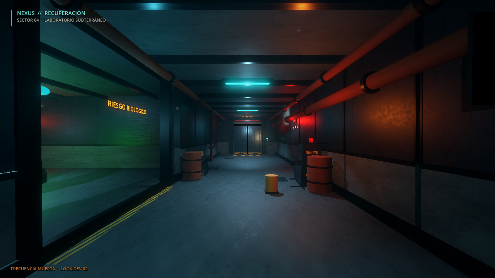
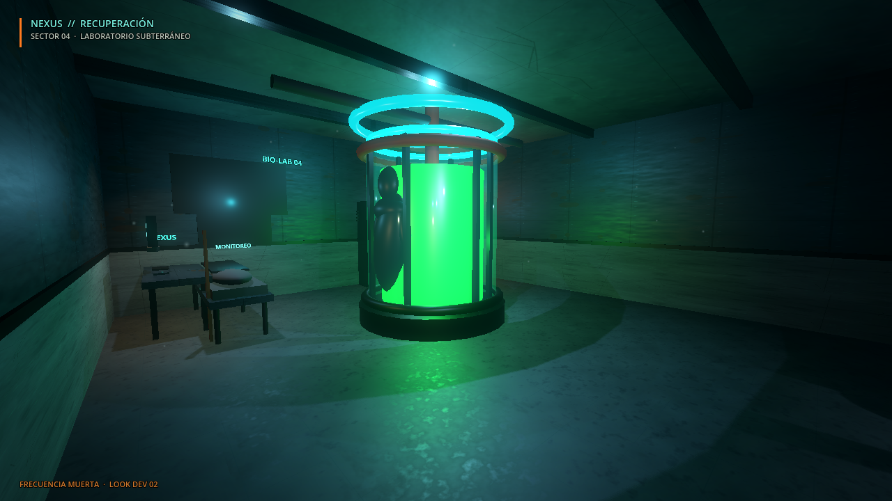
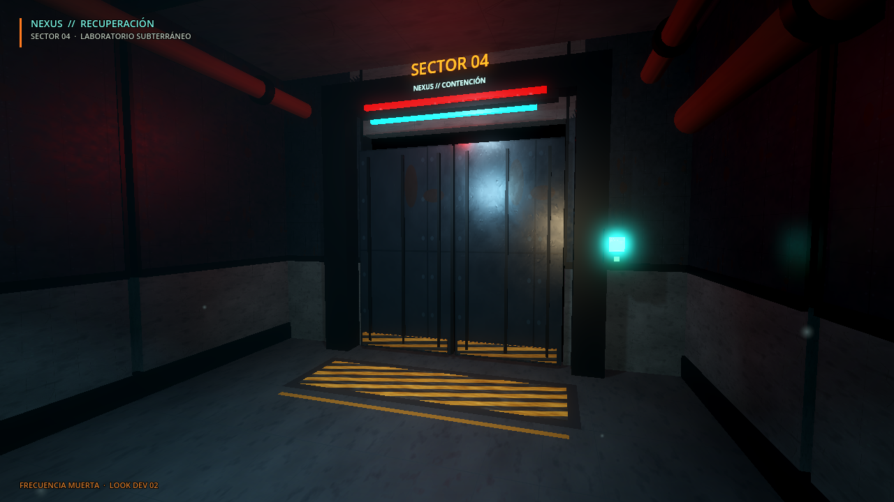

# FRECUENCIA MUERTA — Fase 2: identidad visual y look dev

**Lema:** "No todas las voces que escuchas pertenecen a tus compañeros".

Este documento resume el look dev inicial: una sala industrial construida para validar atmósfera, materiales, iluminación y composición antes de invertir en el vertical slice jugable.

## Capturas

### Corredor de acceso



### Laboratorio de contención



### Puerta de seguridad



## Cómo abrirlo

```bash
godot --path ~/Documentos/game scenes/fm/lookdev.tscn
```

Vistas disponibles:

```bash
godot --path ~/Documentos/game scenes/fm/lookdev.tscn -- --view=0
godot --path ~/Documentos/game scenes/fm/lookdev.tscn -- --view=1
godot --path ~/Documentos/game scenes/fm/lookdev.tscn -- --view=2
```

`--view=3` es una vista de depuración para inspeccionar el tanque de contención.

## Dirección visual

- Terror industrial cinematográfico, con ciencia ficción corporativa y decadencia.
- Paleta: casi negro azul/verde, cian tecnológico, rojo de emergencia, ámbar de trabajo y verde biológico.
- Luz low-key con fuentes prácticas, niebla volumétrica, humo y superficies húmedas.
- Materiales PBR: hormigón deteriorado, metal oxidado, pintura descascarada, cristal, goma y superficies reflectantes.
- Composición con punto de fuga, marcos de puerta, siluetas y oclusión en primer plano.
- La referencia es el lenguaje visual de `fotos-referencia/`; esas imágenes no se usan como assets ni se modificaron.

## Qué contiene la escena

- Corredor de 5.4 x 22 m con paneles de hormigón y metal, techo con vigas, tuberías, cables, rejillas y señalización NEXUS.
- Laboratorio lateral con tanque de contención, silueta humanoide, goo verde, camilla cubierta, escritorio, monitor, cabinas, estanterías y taquilla.
- Puerta de seguridad doble con franjas de peligro, keypad, barra de estado, luces de emergencia y cartel "SECTOR 04".
- Polvo en suspensión, vapor, calcomanías de suciedad y luces de emergencia.
- Overlay mínimo con identidad NEXUS y viñeta.

No hay jugador, criaturas, IA, loot, red ni interacción: es una escena visual, no una demo jugable.

## Assets y licencias

Todas las texturas y materiales de `assets/art/fm/` son originales y se generan de forma reproducible con:

```bash
python3 tools/generate_fm_art.py
```

No se usaron assets externos. Las imágenes de `fotos-referencia/` son solo referencias y no forman parte del juego.

## Rendimiento

Medido en la GTX 1650 Ti del equipo de desarrollo, Forward+, sin VSync:

| Resolución | Vista | FPS aproximados |
|---|---|---:|
| 1280x720 | Corredor | 172-174 |
| 1920x1080 | Corredor | 95-99 |
| 1920x1080 | Laboratorio | 92-94 |

El modo `--write-movie` no sirve para medir FPS reales: la codificación del video infla el tiempo por frame. El proyecto pasó de GL Compatibility a **Forward+** para habilitar niebla volumétrica, SSAO, SSR y glow.

## Limitaciones actuales

- La geometría es un blockout procedural; todavía no es arte final.
- No hay personajes, criaturas, animaciones, inventario, herramientas ni interacción.
- No hay red ni lobby.
- El menú y el nombre del proyecto siguen siendo los del prototipo anterior; el rebranding completo queda para una fase posterior.

## Siguiente paso

Convertir esta base en el **vertical slice** de FRECUENCIA MUERTA: pasillo, laboratorio y puerta de seguridad jugables, linterna, escondite, un objeto físico, una criatura de prueba (El Vigilante), sonido ambiental y una extracción. Sin armas y sin combate.
