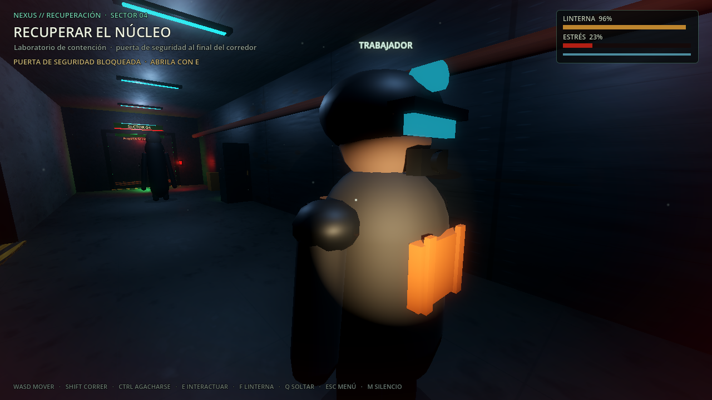

# FRECUENCIA MUERTA — Red 3D (P2)

Esta fase lleva el vertical slice de Frecuencia Muerta a **dos instancias conectadas**
con ENet. El host ejecuta la partida y los clientes controlan a su propio trabajador.
No se rehizo el nivel ni el menú: se reutilizan la escena del slice, los materiales,
el audio y la conexión ENet que ya usaba el prototipo 2D.



## Cómo jugar

En la misma PC:

```bash
godot --path ~/Documentos/game -- --host3d
godot --path ~/Documentos/game -- --join3d=127.0.0.1
```

También desde el menú:

1. Una instancia elige **CREAR PARTIDA 3D (HOST)** y entra directamente al slice.
2. La otra escribe la IP del host (o `127.0.0.1`) y elige **UNIRSE 3D**.
3. El host espera dentro del corredor; el cliente aparece en su propio punto de spawn.

Puerto: **UDP 7777**. Para LAN se usa la IP local del host. Para internet hay que abrir
o redirigir el puerto en el router; todavía no hay NAT punch ni lobbies de Steam.

## Qué está sincronizado

| Sistema | Autoridad | Sincronización |
|---|---|---|
| Jugadores | Cada cliente mueve su avatar; el host valida acciones | Posición, orientación, escondite y observación a 20 Hz |
| Avatares remotos | Cliente de origen, replicado por el host | Interpolación visual en el cliente y en el host |
| Núcleo | Host | Portador y posición |
| Puerta de seguridad | Host | Estado abierto y apertura visual |
| Baterías | Host | Índice recogido y recarga del jugador que la tomó |
| Trampa sonora | Host | Estado activado |
| El Vigilante | Host | Posición, orientación y estado de la FSM |
| Extracción y final | Host | Victoria/derrota y overlay |
| Desconexión | Host | El jugador remoto desaparece; si cae el host, el cliente termina |

El host simula la criatura y decide el final de la partida. Los clientes no ejecutan la
FSM del Vigilante. Las interacciones de un cliente se envían al host, que comprueba la
distancia y el estado antes de aplicarlas.

## Arquitectura

- `scripts/fm/fm_net.gd` (`FMNet`): capa ENet del slice. Detecta host/cliente y contiene
  los RPC de roster, estado de jugador, mundo, interacciones, puerta, batería, trampa,
  portador, escondite y final.
- `scripts/fm/fm_remote_player.gd` (`FMRemotePlayer`): avatar procedural de un compañero
  remoto. No simula física ni input; interpola posición/orientación y muestra el estado
  de carga.
- `scripts/fm/vertical_slice.gd`: conserva la construcción offline del nivel y añade el
  roster, los puntos de spawn, los callbacks de red y la validación del host.
- `tests/fm_net_probe.tscn` + `tests/fm_net_probe.gd`: cliente de prueba con la misma
  raíz (`VerticalSlice`) que la escena real, para que los NodePath de los RPC coincidan.
- `tests/run_net_3d_check.sh`: levanta un host headless y ejecuta el probe.

La red se activa reutilizando el mismo patrón de `main.gd`/`player.gd` del prototipo
2D: RPC de alto nivel, `rpc_id(1)` para peticiones y difusión del estado autoritativo.

## Pruebas

```bash
bash tests/run_net_3d_check.sh
# o toda la suite:
bash tests/run_all.sh
```

Resultado actual de la red 3D: **15/15 PASS**.

Comprueba conexión, roster host+cliente, spawns separados, batería replicada y recarga,
puerta cerrada/abierta, recogida del núcleo aceptada por el host, núcleo en manos del
cliente, extracción y victoria, y HUD del cliente.

También se verificó visualmente una instancia host y una cliente en ventanas separadas:
el cliente ve el corredor, el HUD y la instalación con el estado de red.

## Limitaciones honestas

- **Movimiento cliente-autoritativo:** cada cliente reporta su posición. El host valida
  interacciones por distancia, pero no simula el movimiento ni corrige teleports. Es
  suficiente para el prototipo cooperativo, no para anticheat competitivo.
- Sin reconexión, migración de host, lobbies de Steam, invitaciones ni voz por proximidad.
- Sin El Imitador, inventario, herramientas, base ni progresión todavía.
- El arte del nivel, el Vigilante y los objetos sigue siendo geometría procedural
  provisional; el lookdev de Fase 2 es la referencia visual, no el arte final.
- La prueba automatizada es de 2 instancias. El roster admite hasta 4, pero 3-4
  jugadores todavía necesitan una prueba de estrés y ajuste de spawns.
- Los tests headless dejan avisos de recursos al forzar la salida; no son fallos de
  gameplay.

## Controles

| Acción | Tecla |
|---|---|
| Mover | WASD |
| Mirar | Mouse |
| Correr / agacharse | Shift / Ctrl |
| Interactuar, recoger, esconderse, abrir puerta | E |
| Soltar el núcleo | Q |
| Linterna | F |
| Volver al menú | Esc |
| Terminar: reintentar (offline) / volver al menú (online) | R |
| Silenciar audio | M |
