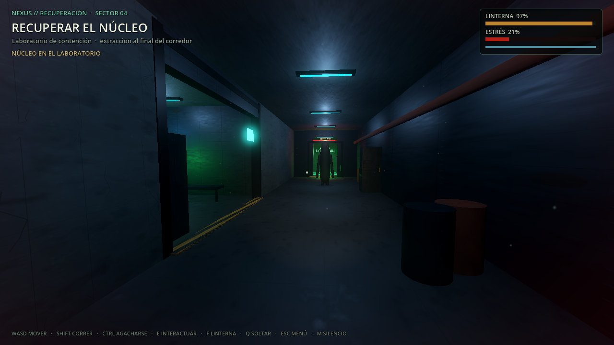
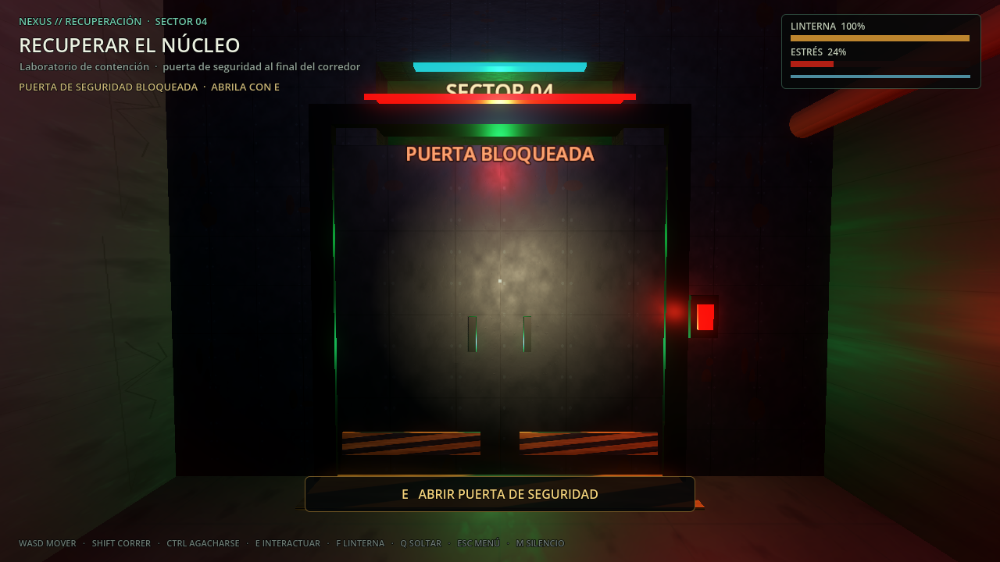
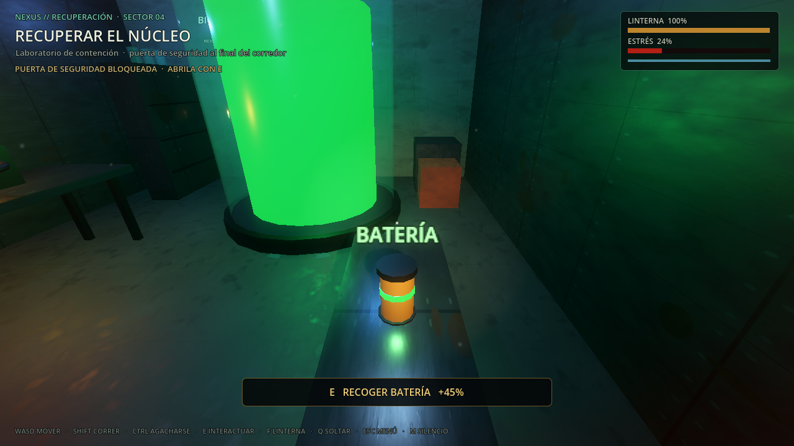

# FRECUENCIA MUERTA — Vertical slice offline

Estado: **primera versión jugable con pulido P1**, offline y de un solo jugador.
No es la versión final ni tiene red.

## Objetivo

Validar el bucle mínimo de terror y extracción:

1. Entrar en el corredor.
2. Localizar el núcleo en el laboratorio.
3. Recogerlo y transportarlo.
4. Evitar a El Vigilante.
5. Usar un escondite si hace falta.
6. Abrir la puerta de seguridad al final del corredor.
7. Llegar a la extracción con el núcleo.

Sin armas, sin combate y sin posibilidad de matar a la criatura.

| Captura | Qué muestra |
|---|---|
|  | Vista general del corredor, el laboratorio y El Vigilante |
|  | Puerta interactiva cerrada, con prompt de interacción |
|  | Batería recogible para recargar la linterna |

## Cómo abrir

Desde el menú: **ENTRAR A LA INSTALACIÓN**.

Desde terminal:

```bash
godot --path ~/Documentos/game -- --slice
```

O directamente:

```bash
godot --path ~/Documentos/game scenes/fm/vertical_slice.tscn
```

## Controles

| Acción | Tecla |
|---|---|
| Mover | WASD |
| Mirar | Mouse |
| Correr | Shift |
| Agacharse | Ctrl |
| Interactuar / recoger / esconderse / salir / abrir puerta | E |
| Soltar el núcleo | Q |
| Linterna | F |
| Volver al menú | Esc |
| Silenciar audio | M |

## Sistemas implementados

- **Jugador FP modular** (`scripts/fm/fm_player.gd`): movimiento, sprint con
  resistencia, crouch, cámara, linterna con batería, interacción por línea de vista,
  transporte y escondites.
- **Núcleo físico** (`scripts/fm/fm_carry_item.gd`): `RigidBody3D`, masa, caída y ruido
  al soltarse; mientras se transporta se congela y sigue un ancla del jugador.
- **El Vigilante** (`scripts/fm/fm_watcher.gd`): patrulla, investiga ruido, persigue,
  busca y se detiene cuando el jugador lo observa. No se puede matar.
- **Escondites** (`scripts/fm/fm_hiding_spot.gd`): dos armarios; entrar y salir con E.
- **Extracción** (`scripts/fm/fm_extraction.gd`): completar la partida con el núcleo.
- **HUD** (`scripts/fm/fm_hud.gd`): objetivo, batería, estrés, resistencia, avisos,
  viñeta y pantalla de fin.
- **Escenario** (`scripts/fm/vertical_slice.gd`): corredor, laboratorio, tanque,
  puerta de seguridad, luces, niebla, polvo y props con colisión.
- **Puerta de seguridad interactiva** (`scripts/fm/fm_security_door.gd`): dos hojas
  con colisión, keypad, prompt, apertura con E y ruido que puede atraer al Vigilante.
- **Baterías recogibles** (`scripts/fm/fm_battery.gd`): dos unidades que recargan un
  45% de la linterna, hacen ruido al recogerse y desaparecen.
- **Trampa sonora** (`scripts/fm/fm_noise_trap.gd`): cristales y latas en el corredor;
  al pisarla emite ruido y atrae al Vigilante. No hace daño.
- **Audio ambiental 3D** (`assets/audio/ambience/ambience.wav`): loop industrial de
  24 segundos reproducido con `AudioStreamPlayer3D`; el jugador tiene `AudioListener3D`.
- **Audio y atmósfera**: música existente, pasos, recogida, caída, escondite,
  extracción, puerta, batería y trampa; sin voz todavía.

## Pruebas

```bash
godot --headless --path . tests/fm_slice_smoke.tscn
```

Cubre jugador, Vigilante, núcleo, extracción, escondites, HUD, observación,
recogida, esconderse/salir, linterna inicial, victoria, puerta, batería, trampa y
audio ambiental. Resultado actual: **26/26 PASS**.

## Multijugador 3D (P2)

La puerta, las baterías, la trampa, el núcleo, el Vigilante y la extracción ya se
sincronizan en una partida host-autoritativa de dos instancias. El host simula la
partida; cada cliente mueve su avatar y el host valida sus interacciones. El detalle
técnico, los comandos y los límites están en [fm_online.md](fm_online.md).

## Limitaciones

- Dos instancias probadas; el roster admite hasta cuatro, pero falta una prueba de
  estrés con tres o cuatro jugadores.
- Sin voz, sin Imitador, sin reconexión y sin lobbies de Steam.
- El movimiento es cliente-autoritativo con validación de distancia en el host; no hay
  simulación completa del movimiento en el servidor.
- El Vigilante y el núcleo usan geometría procedural provisional.
- No hay inventario, base, progresión ni misiones.
- El escenario es un blockout con materiales de Fase 2, no arte final.
- Los avisos de recursos al cerrar los tests son de la salida forzada.

## Siguiente paso

Probar tres o cuatro jugadores, pulir la sincronización del Vigilante y de los objetos,
y después avanzar a salas/lobbies, voz por proximidad y El Imitador.
