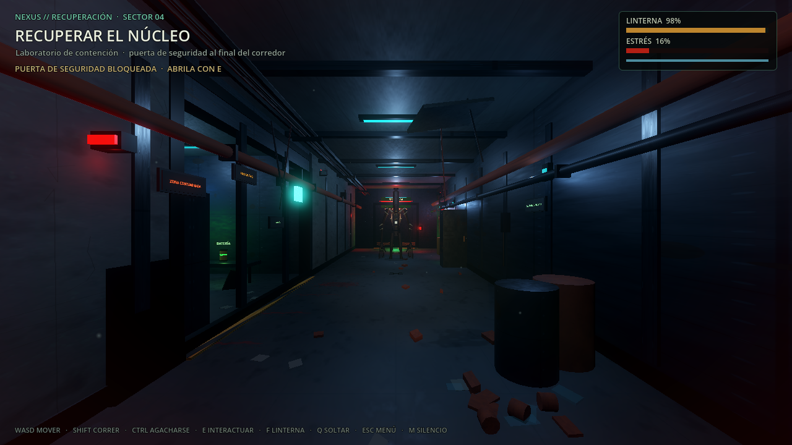
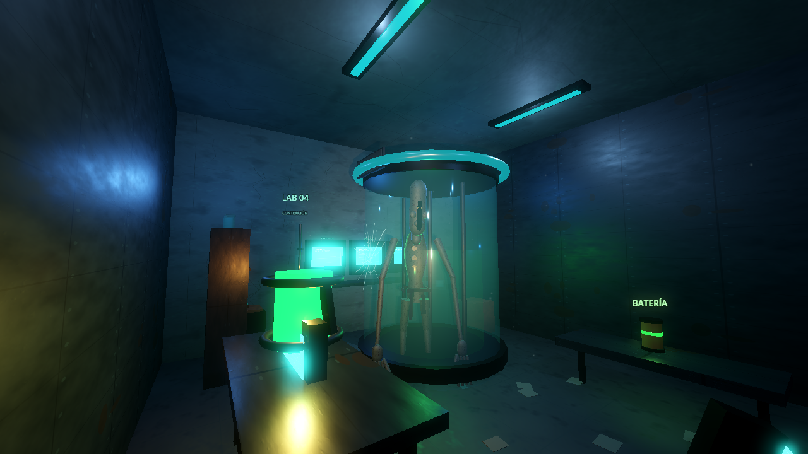
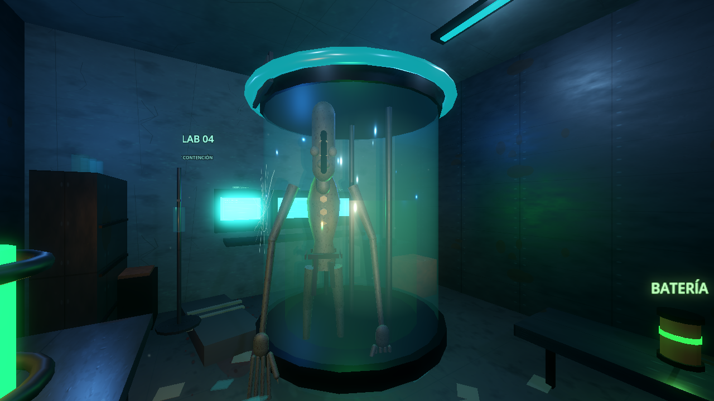
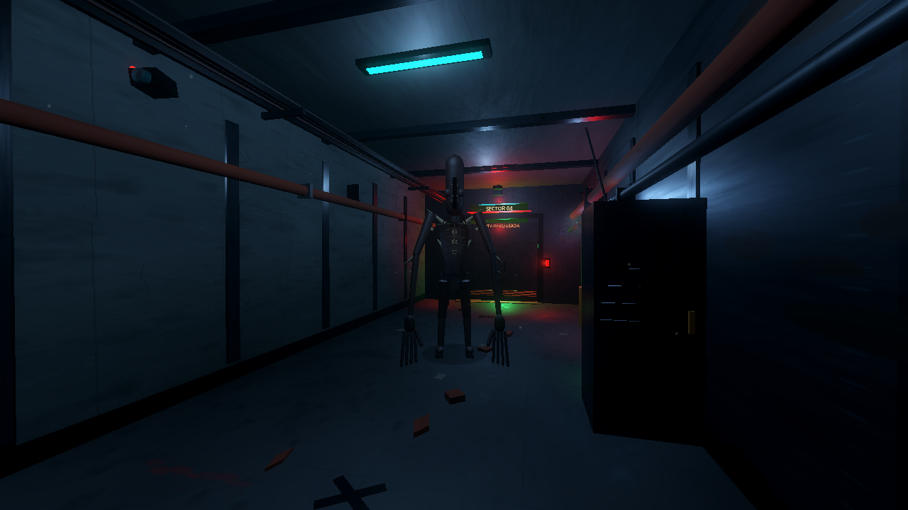

# FRECUENCIA MUERTA — Referencia visual del vertical slice

Este documento fija el estado visual del **vertical slice jugable** y lo usa como
referencia para las próximas instalaciones, habitaciones, props y criaturas. No es
una escena de look dev: el corredor, el laboratorio, el tanque y El Vigilante se
pueden recorrer en primera persona.

## Capturas

| Captura | Qué muestra |
|---|---|
|  | Corredor de acceso: vigas, costillas, tuberías, carteles con placa, luces de emergencia, escombros, charcos y rastro de sangre. |
|  | Laboratorio: tanque de contención, consola de observación, camilla, batería, cuerpo en bolsa y núcleo sobre el escritorio. |
|  | Detalle del tanque: goo bajo, vidrio, anillo metálico con tira cian, barras frontales y silueta del Imitador. |
|  | El Vigilante leído como silueta: torso orgánico, púas, brazos largos y boca vertical, integrado en la iluminación del corredor. |

## Dirección visual aplicada

- **Paleta**: base azul-verde casi negra; cian tecnológico, rojo de emergencia,
  ámbar de trabajo y verde biológico.
- **Arquitectura**: corredor de 5,4 × 24 m con paneles metálicos, hormigón,
  costillas estructurales, vigas, bandejas de cables, tuberías, rejillas,
  cámaras, cajas eléctricas y carteles de NEXUS.
- **Deterioro**: paneles desprendidos, cables colgando, escombros, cristales,
  papeles, charcos, sangre y huellas. La destrucción se concentra en zonas
  concretas para alternar áreas intactas y devastadas.
- **Laboratorio**: tanque de contención con grieta, consola de tres monitores,
  instrumental, camilla, soporte de suero, cuerpo en bolsa, taquilla y avisos
  de contención fallida.
- **Iluminación**: fixtures fríos, luz verde del tanque, ámbar de trabajo, rojo
  de emergencia y spots volumétricos. La linterna del jugador es la fuente
  principal en las zonas oscuras.
- **Materiales**: PBR procedurales de hormigón, metal oxidado, suelo húmedo,
  óxido, goma, cristal, goo, tela, carne y hueso. Las texturas se generan con
  `tools/generate_fm_art.py` y `tools/generate_visual_detail.py`.

## Criaturas

La referencia oficial es `fotos-referencia/modelos-referencia.png` (El Imitador,
El Vigilante, El Coleccionista y La Sombra). No se modifica ni se usa como
textura. Los modelos actuales son **recursos procedurales independientes**:

- **El Vigilante**: silueta alta y delgada, torso orgánico de una pieza, cintura
  hundida, púas dorsales y de hombros, brazos largos con garras, cabeza alargada
  y boca vertical negra. Respeta los rasgos principales de la referencia.
- **El Imitador**: dentro del tanque, más pálido y delgado, sin púas ni ojos
  visibles, con cabeza y boca vertical grandes. Es una presencia de contención,
  no el sistema de imitación de voz definitivo.

**Estado honesto**: son modelos de bloqueo orgánico, no arte final. Sirven para
validar escala, silueta, legibilidad en poca luz e integración con el escenario.
La calidad de carne, anatomía fina, rig y animaciones finales requiere modelado
3D dedicado en una fase posterior. No se afirma fotorrealismo.

## Rendimiento medido

Medición con `--disable-vsync --print-fps` en el corredor del vertical slice,
GTX 1650 Ti 4 GB, Forward+, usando el driver de captura (no una build final):

| Resolución | FPS observados |
|---|---|
| 1280 × 720 | ~206 FPS |
| 1920 × 1080 | ~95–103 FPS |

Son mediciones de una escena de prueba con un jugador y el Vigilante. No
representan el rendimiento del juego completo con red, más criaturas, físicas y
efectos.

## Cómo abrirla

```bash
godot --path ~/Documentos/game -- --slice
```

O desde el menú: **ENTRAR A LA INSTALACIÓN**.

Controles: WASD, mouse, Shift para correr, Ctrl para agacharse, E para
interactuar, Q para soltar el núcleo, F para la linterna, Esc para volver al
menú y M para silenciar.

## Limitaciones

- Una sola instalación pequeña (corredor, laboratorio, extracción), no un mapa
  completo.
- Geometría y criaturas procedurales; no hay modelos 3D finales ni rigs.
- El Imitador no imita voces todavía; es una presencia en el tanque.
- Sin nuevas criaturas, inventario, herramientas avanzadas, base ni progresión.
- El rendimiento debe volver a medirse cuando se agreguen red, más IA y efectos.

## Siguiente paso

Usar estas capturas como referencia de composición, luz y densidad para las
próximas habitaciones. Antes de ampliar el mapa, conviene validar el slice en
una prueba manual con dos jugadores y después avanzar con el modelo definitivo
de El Vigilante y las demás criaturas.
